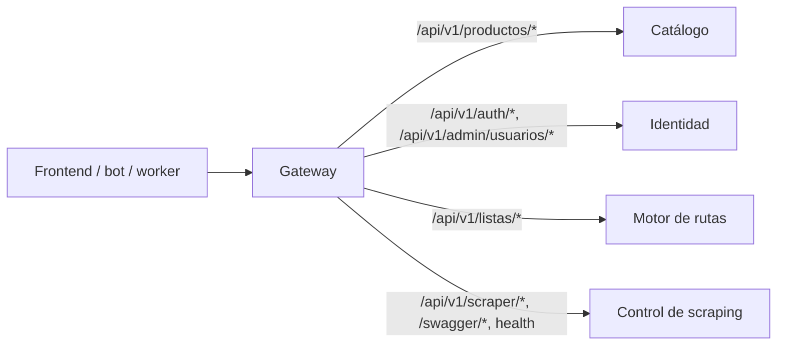

# Gateway — SUP-264 a SUP-273 / Barrido SUP-350

Servicio Go independiente que enruta productos y administración de productos a
Catálogo, autenticación a Identidad, listas a Motor de rutas y scraping a Control
de scraping. No incluye reglas de negocio ni conexión directa a PostgreSQL o Redis.

## Flujo de enrutamiento



| Ruta / Prefijo | Destino upstream | Comportamiento |
|---|---|---|
| `/api/v1/productos` y subrutas | Catálogo (`CATALOGO_URL`) | Consultas de catálogo y detalle público |
| `/api/v1/admin/productos` y subrutas | Catálogo (`CATALOGO_URL`) | Gestión administrativa de catálogo |
| `/api/v1/auth` y subrutas | Identidad (`IDENTIDAD_URL`) | Login, registro, sesiones y OAuth |
| `/api/v1/admin/usuarios` y subrutas | Identidad (`IDENTIDAD_URL`) | Métricas y administración de cuentas |
| `/api/v1/listas` y subrutas | Motor de rutas (`RUTAS_URL`) | CRUD de listas de compras (SUP-240) |
| `/api/v1/scraper/*`, `/swagger/*` | Control (`SCRAPING_URL`) | Coordinación de scraping y documentación |
| `/`, `/health`, `/api/v1/health` | Control (`SCRAPING_URL`) | Healthchecks heredados agregados |
| `/_gateway/live`, `/_gateway/ready` | Gateway (local) | Liveness y readiness del proceso router |
| `/_gateway/dependencies` | Gateway (agregado) | Diagnóstico conjunto de upstreams en paralelo |

El enrutamiento comprueba el segmento completo (por ejemplo, `/api/v1/productos-falso`
no coincide con Catálogo). No se normalizan rutas ni se realiza fallback silencioso
entre destinos: si Catálogo falla, responde 502/504 identificando el servicio caído.

## Ejecutar

Requiere Go 1.26 y los servicios de dominio en ejecución. Desde `backend/gateway`:

```bash
SCRAPING_URL=http://127.0.0.1:8080 CATALOGO_URL=http://127.0.0.1:8083 IDENTIDAD_URL=http://127.0.0.1:8084 go run ./cmd/gateway
```

Escucha por defecto en el puerto 8082. Para validar localmente:

```bash
curl -fsS http://127.0.0.1:8082/_gateway/live
curl -fsS http://127.0.0.1:8082/_gateway/ready
curl -fsS http://127.0.0.1:8082/_gateway/dependencies
curl -fsS http://127.0.0.1:8082/api/v1/health
curl -fsS 'http://127.0.0.1:8082/api/v1/productos?page=1&limit=5'
```

`/_gateway/live` y `/_gateway/ready` comprueban el proceso y el router configurado.
`/_gateway/dependencies` consulta en paralelo la salud de Control, Catálogo,
Identidad y Motor de rutas con un límite común (`GATEWAY_READINESS_TIMEOUT`) y sin
seguir redirects. Responde 503 si alguno falla. Este diagnóstico está desacoplado del
readiness probe de Kubernetes para evitar que la caída de un servicio retire el
tráfico hacia los dominios sanos.

## Configuración (.env)

Ver `.env.example` para una plantilla lista para usar.

| Variable | Valor por defecto | Uso |
|---|---|---|
| `SCRAPING_URL` | Vacío en modo legado; requerida en despliegue final | Origen HTTP/HTTPS de Control de scraping |
| `BACKEND_URL` | Obligatoria sólo sin `SCRAPING_URL` | Origen de respaldo para rollback hacia API monolítica |
| `CATALOGO_URL` | Vacío | Origen HTTP/HTTPS de Catálogo |
| `IDENTIDAD_URL` | Vacío | Origen HTTP/HTTPS de Identidad |
| `RUTAS_URL` | Vacío | Origen HTTP/HTTPS del motor de rutas; vacío devuelve 404 en `/api/v1/listas` |
| `GATEWAY_LISTEN_ADDR` | `:8082` | Dirección y puerto de escucha |
| `GATEWAY_REQUEST_TIMEOUT` | `30s` | Tiempo límite total de la solicitud proxificada |
| `GATEWAY_DIAL_TIMEOUT` | `5s` | Límite para conexión y handshake TLS con el upstream |
| `GATEWAY_RESPONSE_HEADER_TIMEOUT` | `10s` | Espera de cabeceras de respuesta del upstream |
| `GATEWAY_READ_HEADER_TIMEOUT` | `5s` | Lectura de cabeceras enviadas por el cliente |
| `GATEWAY_IDLE_TIMEOUT` | `60s` | Tiempo máximo de conexión inactiva |
| `GATEWAY_SHUTDOWN_TIMEOUT` | `10s` | Espera de peticiones activas ante SIGINT/SIGTERM |
| `GATEWAY_READINESS_TIMEOUT` | `2s` | Límite conjunto para `/_gateway/dependencies` |
| `GATEWAY_KEEPALIVE_TIMEOUT` | `30s` | Keep-alive de conexiones de lectura hacia upstreams |
| `GATEWAY_TRUSTED_PROXIES` | Vacío | IPs o CIDRs de proxies reversos de entrada confiables |
| `GATEWAY_CATALOGO_PREFIXES` | `/api/v1/productos,/api/v1/admin/productos` | Prefijos enrutados a Catálogo |
| `GATEWAY_IDENTIDAD_PREFIXES` | `/api/v1/auth,/api/v1/admin/usuarios` | Prefijos enrutados a Identidad |
| `GATEWAY_RUTAS_PREFIXES` | `/api/v1/listas` | Prefijos enrutados a Motor de rutas |
| `GATEWAY_SCRAPING_PREFIXES` | `/api/v1/scraper,/swagger` | Prefijos enrutados a Control de scraping |

Los timeouts deben ser duraciones positivas de Go (`500ms`, `5s`, `30s`). Una
configuración inválida aborta el arranque con mensaje explicativo.

## Transparencia y seguridad de la entrada

- Conserva método, path codificado, query, cuerpo, cabecera `Host` y códigos HTTP.
- Propaga cookies, `Authorization`, cabeceras CORS y redirects.
- Inyecta o propaga `X-Request-ID` (hasta 128 caracteres seguros).
- **Elimina cabeceras de identidad falsificables**: descarta `X-User-ID`, `X-Role` y
  `X-User-Role` enviadas por el cliente para evitar suplantaciones.
- Reconstruye `X-Forwarded-*`: con `GATEWAY_TRUSTED_PROXIES` configurado, recorre la
  cadena desde el salto más cercano hasta el primer proxy no confiable para fijar la
  IP real del cliente.
- Las lecturas (`GET`, `HEAD`, `OPTIONS`, `TRACE`) reutilizan conexiones. Las
  escrituras (`POST`, `PUT`, `DELETE`, `PATCH`) abren una conexión nueva sin
  reintentos automáticos para proteger operaciones con `Idempotency-Key`.
- Si un upstream no responde, devuelve HTTP 502 (`<servicio>_unavailable`) o
  HTTP 504 (`<servicio>_timeout`), con JSON estructurado que incluye el `request_id`.

## Procedimiento de Rollback y Despliegue (SUP-268 / SUP-272)

Si Catálogo o Identidad presentan fallas críticas durante un despliegue:
1. En Compose, Gateway permite operar en modo legado conservando `BACKEND_URL` y
   vaciando `CATALOGO_URL` o `IDENTIDAD_URL`.
2. Para Identidad, Compose utiliza el alias `identidad-upstream` en una red aislada
   con IP fija de Gateway. Identidad confía únicamente en esa IP para preservar la
   trazabilidad del cliente.
3. No se requiere migración destructiva ni borrado de volúmenes para revertir el
   enrutamiento; basta con reiniciar Gateway con las variables de origen deseadas.

## Pruebas y estructura de tests

Las pruebas del Gateway se encuentran organizadas en `tests/` fuera del código de aplicación:

```
backend/gateway/
  cmd/gateway/         ← binario principal
  internal/
    config/            ← carga y validación de variables de entorno
    proxy/             ← reverse proxy, handlers y dependencias
  tests/
    unit/              ← pruebas unitarias de configuración (tests/unit/config_test.go)
    integration/       ← pruebas de proxy HTTP end-to-end con servidores locales
```

Para ejecutar las pruebas:

```bash
cd backend/gateway
go test -race ./...
go vet ./...
go build ./cmd/gateway
```

Para ejecutar las pruebas de integración en Compose desde la raíz:

```bash
bash scripts/smoke_catalogo_routing_compose.sh
```
