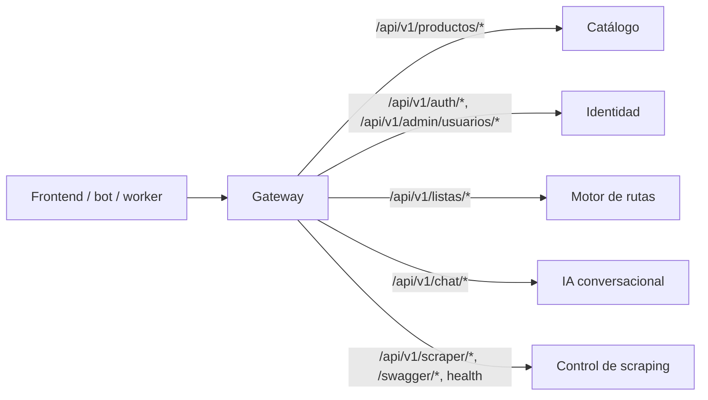

# Gateway — SUP-264 a SUP-273 / Barridos SUP-350 y SUP-386

Servicio Go independiente que enruta productos y administración de productos a
Catálogo, autenticación a Identidad, listas a Motor de rutas y scraping a Control
de scraping. No incluye reglas de negocio ni conexión directa a PostgreSQL o Redis.

## Flujo de enrutamiento



| Ruta / Prefijo | Destino upstream | Comportamiento |
|---|---|---|
| `/api/v1/productos` y subrutas | Catálogo (`CATALOGO_URL`) | Consultas de catálogo y detalle público |
| `/api/v1/admin/productos` y subrutas | Catálogo (`CATALOGO_URL`) | Gestión administrativa de catálogo |
| `/api/v1/auth` y subrutas | Identidad (`IDENTIDAD_URL`) | Login, registro, sesiones y OAuth |
| `/api/v1/admin/usuarios` y subrutas | Identidad (`IDENTIDAD_URL`) | Métricas y administración de cuentas |
| `/api/v1/listas` y subrutas | Motor de rutas (`RUTAS_URL`) | CRUD de listas de compras (SUP-240) |
| `/api/v1/chat` y subrutas | IA conversacional (`IA_URL`) | Interacción con asistente de IA conversacional (SUP-278) |
| `/api/v1/scraper/*`, `/swagger/*` | Control (`SCRAPING_URL`) | Coordinación de scraping y documentación |
| `/`, `/health`, `/api/v1/health` | Control (`SCRAPING_URL`) | Salud pública de Control |
| Cualquier otra ruta | Gateway (local) | 404 JSON `{"estado":404,"mensaje":...}`; no hay respaldo hacia otro servicio |
| `/_gateway/live`, `/_gateway/ready` | Gateway (local) | Liveness y readiness del proceso router |
| `/_gateway/dependencies` | Gateway (agregado) | Diagnóstico conjunto de upstreams en paralelo |

El enrutamiento comprueba el segmento completo (por ejemplo, `/api/v1/productos-falso`
no coincide con Catálogo). No se normalizan rutas ni se realiza fallback silencioso
entre destinos: si Catálogo falla, responde 502/504 identificando el servicio caído.

## Ejecutar

Requiere Go 1.26 y los servicios de dominio en ejecución. Desde `backend/gateway`:

```bash
SCRAPING_URL=http://127.0.0.1:8080 CATALOGO_URL=http://127.0.0.1:8083 IDENTIDAD_URL=http://127.0.0.1:8084 go run ./cmd/gateway
```

Escucha por defecto en el puerto 8082. Para validar localmente:

```bash
curl -fsS http://127.0.0.1:8082/_gateway/live
curl -fsS http://127.0.0.1:8082/_gateway/ready
curl -fsS http://127.0.0.1:8082/_gateway/dependencies
curl -fsS http://127.0.0.1:8082/api/v1/health
curl -fsS 'http://127.0.0.1:8082/api/v1/productos?page=1&limit=5'
```

`/_gateway/live` y `/_gateway/ready` comprueban el proceso y el router configurado.
`/_gateway/dependencies` consulta en paralelo la salud de Control, Catálogo,
Identidad, Motor de rutas e IA conversacional con un límite común (`GATEWAY_READINESS_TIMEOUT`) y sin
seguir redirects. Responde 503 si alguno falla. Este diagnóstico está desacoplado del
readiness probe de Kubernetes para evitar que la caída de un servicio retire el
tráfico hacia los dominios sanos.

## Configuración (.env)

Ver `.env.example` para una plantilla lista para usar.

| Variable | Valor por defecto | Uso |
|---|---|---|
| `SCRAPING_URL` | **Obligatoria** | Origen HTTP/HTTPS de Control de scraping; sin ella el Gateway no arranca |
| `CATALOGO_URL` | Vacío | Origen HTTP/HTTPS de Catálogo; sin él `/api/v1/productos` responde 404 |
| `IDENTIDAD_URL` | Vacío | Origen HTTP/HTTPS de Identidad; sin él `/api/v1/auth` responde 404 |
| `RUTAS_URL` | Vacío | Origen HTTP/HTTPS del motor de rutas; sin él `/api/v1/listas` responde 404 |
| `IA_URL` | Vacío | Origen HTTP/HTTPS de IA conversacional; sin ella `/api/v1/chat` responde 404 |
| `GATEWAY_LISTEN_ADDR` | `:8082` | Dirección y puerto de escucha |
| `GATEWAY_REQUEST_TIMEOUT` | `30s` | Tiempo límite total de la solicitud proxificada |
| `GATEWAY_DIAL_TIMEOUT` | `5s` | Límite para conexión y handshake TLS con el upstream |
| `GATEWAY_RESPONSE_HEADER_TIMEOUT` | `10s` (Compose: `20s`) | Espera de cabeceras de respuesta del upstream; Compose la amplía por la latencia de IA |
| `GATEWAY_READ_HEADER_TIMEOUT` | `5s` | Lectura de cabeceras enviadas por el cliente |
| `GATEWAY_IDLE_TIMEOUT` | `60s` | Tiempo máximo de conexión inactiva |
| `GATEWAY_SHUTDOWN_TIMEOUT` | `10s` | Espera de peticiones activas ante SIGINT/SIGTERM |
| `GATEWAY_READINESS_TIMEOUT` | `2s` | Límite conjunto para `/_gateway/dependencies` |
| `GATEWAY_KEEPALIVE_TIMEOUT` | `30s` | Keep-alive de conexiones de lectura hacia upstreams |
| `GATEWAY_TRUSTED_PROXIES` | Vacío | IPs o CIDRs de proxies reversos de entrada confiables |
| `GATEWAY_CATALOGO_PREFIXES` | `/api/v1/productos,/api/v1/admin/productos` | Prefijos enrutados a Catálogo |
| `GATEWAY_IDENTIDAD_PREFIXES` | `/api/v1/auth,/api/v1/admin/usuarios` | Prefijos enrutados a Identidad |
| `GATEWAY_RUTAS_PREFIXES` | `/api/v1/listas` | Prefijos enrutados a Motor de rutas |
| `GATEWAY_SCRAPING_PREFIXES` | `/api/v1/scraper,/swagger` | Prefijos enrutados a Control de scraping |
| `GATEWAY_IA_PREFIXES` | `/api/v1/chat` | Prefijos enrutados a IA conversacional |

Los timeouts deben ser duraciones positivas de Go (`500ms`, `5s`, `30s`). Una
configuración inválida aborta el arranque con mensaje explicativo.

Las variables `GATEWAY_*_PREFIXES` son listas separadas por comas. Vacías usan
el valor por defecto. Cada prefijo es un path absoluto (`/api/v1/productos`)
que coincide consigo mismo y con sus rutas hijas (`/api/v1/productos/123`),
pero no con rutas vecinas (`/api/v1/productos-falso`). Reglas al arrancar:

- El `/` final se **recorta**: `/api/v1/productos/` equivale a `/api/v1/productos`.
- Los espacios alrededor de cada coma se ignoran.
- Abortan el arranque, con un error que nombra la variable y el valor: URLs
  completas (`http://...`), paths sin `/` inicial o que empiezan con `//`, query
  (`?`), fragmento (`#`), `%`, espacios internos, segmentos vacíos o `.`/`..`,
  la raíz `/` sola, elementos vacíos (`a,,b` o coma final) y prefijos repetidos,
  ya sea en la misma variable o entre variables distintas.

## Transparencia y seguridad de la entrada

- Conserva método, path codificado, query, cuerpo, cabecera `Host` y códigos HTTP.
- Propaga cookies, `Authorization`, cabeceras CORS y redirects.
- Inyecta o propaga `X-Request-ID` (hasta 128 caracteres seguros).
- **Elimina cabeceras de identidad falsificables**: descarta `X-User-ID`, `X-Role` y
  `X-User-Role` enviadas por el cliente para evitar suplantaciones.
- Reconstruye `X-Forwarded-*`: con `GATEWAY_TRUSTED_PROXIES` configurado, recorre la
  cadena desde el salto más cercano hasta el primer proxy no confiable para fijar la
  IP real del cliente.
- Las lecturas (`GET`, `HEAD`, `OPTIONS`, `TRACE`) reutilizan conexiones. Las
  escrituras (`POST`, `PUT`, `DELETE`, `PATCH`) abren una conexión nueva sin
  reintentos automáticos para proteger operaciones con `Idempotency-Key`.
- Si un upstream no responde, devuelve HTTP 502 (`<servicio>_unavailable`) o
  HTTP 504 (`<servicio>_timeout`), con JSON estructurado que incluye el `request_id`.

## Contratos cambiados en SUP-386

| Antes | Ahora |
|---|---|
| `BACKEND_URL` recibía toda ruta sin dueño (respaldo hacia el monolito retirado) | `BACKEND_URL` no se lee; una ruta sin dueño responde 404 |
| `SCRAPING_URL` era opcional si había `BACKEND_URL` | `SCRAPING_URL` es obligatoria y el arranque falla sin ella; ya la definen `docker-compose.yml:181` e `infrastructure/k8s/gateway/deployment.yaml:33` |
| Ruta sin dueño: con `BACKEND_URL`, la respuesta del monolito; sin ella, `{"estado":404,"mensaje":"La ruta o recurso solicitado no existe."}` | Siempre `{"estado":404,"mensaje":"La ruta o recurso solicitado no existe."}`. El formato no cambia; el frontend sólo lee `mensaje` de forma genérica y ningún smoke lee el cuerpo |
| `/_gateway/dependencies` publicaba los alias `backend`, `database` y `redis` copiados de Control | Sólo `scraping`, `scraping_database` y `scraping_redis` (más las claves de cada dominio configurado) |
| `HEAD` a una ruta sin dueño intentaba escribir cuerpo | `HEAD` responde 404 sin cuerpo |

### Rollback

Los rollbacks hacia el monolito del Sprint 2 se retiraron en SUP-355 y el
respaldo `BACKEND_URL` en SUP-386. Para volver atrás se despliega la imagen
anterior del Gateway junto con su configuración; no hay modo legado en esta.

## Pruebas y estructura de tests

Las pruebas del Gateway se encuentran organizadas en `tests/` fuera del código de aplicación:

```
backend/gateway/
  cmd/gateway/         ← binario principal
  internal/
    config/            ← carga y validación de variables de entorno
    api/               ← enrutador (pasarela.go), proxy (proxy.go), X-Forwarded-* (reenvio.go) y sondas (salud.go)
  tests/
    unit/              ← pruebas unitarias de configuración (tests/unit/config_test.go)
    integration/       ← pruebas de proxy HTTP end-to-end con servidores locales
```

Para ejecutar las pruebas:

```bash
cd backend/gateway
go test -race ./...
go vet ./...
go build ./cmd/gateway
```

En Windows sin cgo, `-race` no está disponible; la etapa `test` del Dockerfile
copia `tests/` y ejecuta lo mismo que el CI:

```bash
docker build --target test backend/gateway
```

Para ejecutar las pruebas de integración en Compose desde la raíz:

```bash
bash scripts/smoke_catalogo_routing_compose.sh
```
