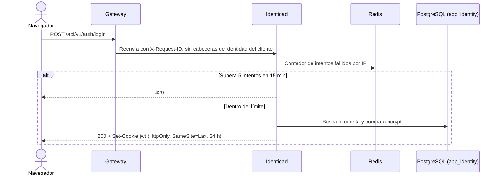
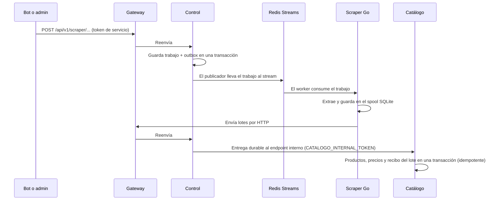

# Arquitectura — Flujo de una petición

[← Índice de arquitectura](README.md)

## Tabla de enrutamiento del Gateway

| Prefijo | Destino |
|---|---|
| `/api/v1/auth/*`, `/api/v1/admin/usuarios/*` | Identidad |
| `/api/v1/productos*`, `/api/v1/admin/productos*` | Catálogo |
| `/api/v1/scraper/*`, `/health`, `/api/v1/health`, `/swagger` | Control de scraping |
| `/api/v1/listas*` | Motor de rutas, solo si se configura `RUTAS_URL` |

## Ejemplo 1 — Login

1. El navegador envía `POST /api/v1/auth/login`. En producción entra por el Ingress `miweb-vmatus.dev.censei.cl/api/v1`.
2. El Gateway asigna un `X-Request-ID`, elimina las cabeceras de identidad del cliente y reenvía la petición a Identidad.
3. Identidad revisa en Redis el contador de intentos fallidos: máximo 5 por IP cada 15 minutos.
4. Identidad verifica la contraseña con bcrypt y responde con `Set-Cookie: jwt=…; HttpOnly; SameSite=Lax`, válida 24 h.
5. El navegador envía la cookie en las siguientes peticiones. Cada servicio la valida por su cuenta: HS256 y `exp` obligatorio.

## Ejemplo 2 — Consulta de catálogo

`GET /api/v1/productos?…` → Gateway → Catálogo → PostgreSQL (rol `app_catalogo`). Es una ruta pública y no requiere cookie.

## Ejemplo 3 — Ciclo de scraping

1. El bot o un admin envía `POST /api/v1/scraper/…` con el token de servicio, y la petición llega a Control.
2. Control guarda el trabajo y su **outbox** en una sola transacción. Un publicador lo lleva después a **Redis Streams**.
3. El Scraper Go consume el trabajo, extrae los datos y los escribe en el **spool SQLite**.
4. El Scraper Go envía los lotes por HTTP: Gateway → Control.
5. Control registra la entrega y la reenvía a Catálogo por el endpoint interno.
6. Catálogo confirma productos, precios y el recibo del lote en una transacción. Si llega un lote repetido, no duplica datos (idempotencia).

## Ejemplo 4 — Logout

`POST /api/v1/auth/logout` → Identidad → `204` con la cookie expirada.

Pendiente: el `logout()` del frontend todavía no llama a este endpoint.
