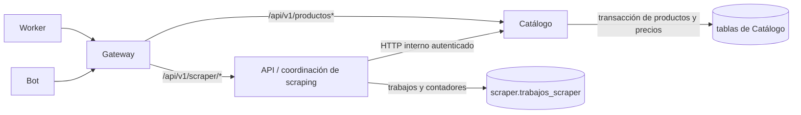

# SUP-269: persistencia de ingesta bajo propiedad de Catálogo

Esta tarea parte de SUP-268 y conserva las rutas usadas por el bot y el worker.
Scraping deja de escribir o consultar directamente tablas de Catálogo y utiliza
un cliente HTTP privado. No hay una biblioteca de entidades compartida.

## Contratos y propiedad

| Operación | Responsable |
| --- | --- |
| `/api/v1/scraper/trabajos`, consulta, ejecución y finalización | Coordinación de scraping |
| `/api/v1/scraper/trabajos/:id/productos` y `/api/v1/scraper/productos` | Coordinación valida y entrega a Catálogo |
| Crear/resolver cadenas y sucursales | Catálogo |
| Upsert de productos y capturas de precios | Catálogo |
| Estado y contador del trabajo | Coordinación de scraping |

Catálogo recibe `sucursal_id` y productos y devuelve los mismos contadores y
mensaje del contrato anterior. No recibe `trabajo_id` ni credenciales de usuario;
el coordinador agrega `trabajo_id` a la respuesta pública cuando corresponde.
El worker no recibe el token interno ni accede a PostgreSQL.

Se retira `ingesta_legacy_repository.go` y el `Preload("Cadena")` de trabajos.
La consulta/finalización obtiene el nombre mediante Catálogo, con plazo de
1 segundo. Si falla esa información auxiliar, conserva el trabajo y omite
`cadena_nombre`. Iniciar trabajos e ingestar sí requieren Catálogo.
Los modelos globales usados por `cmd/seed_productos` permanecen para ese comando
administrativo; no son una dependencia del módulo de scraping. No usar el
sembrador como vía alternativa de ingesta en producción.

## API interna y seguridad

Tres operaciones POST bajo `/internal/v1`:

| Ruta | Payload |
| --- | --- |
| `/cadenas/resolver` | `cadena_id`, `nombre` |
| `/sucursales/resolver` | `cadena_id`, `sucursal_id`, `codigo_sucursal` |
| `/ingestas` | `sucursal_id`, `productos` |

Todas requieren `Authorization: Bearer <CATALOGO_INTERNAL_TOKEN>`, verificado
en tiempo constante. El token tiene al menos 32 caracteres sin espacios y debe
ser diferente de `JWT_SECRET`. No se aceptan cookies JWT o cabeceras de rol como
sustituto. Las peticiones con `Origin` se rechazan incluso con token válido.
El body interno está limitado a 8 MiB, un solo documento JSON y 1–1000 productos;
campos desconocidos, incluido `trabajo_id`, se rechazan. Los errores SQL se
registran internamente y nunca se copian a respuestas públicas.

Gateway no enruta estos endpoints a Catálogo y no hay Ingress ni puerto público
para ellos. El acceso normal usa Service/ClusterIP o la red privada de Compose.
El transporte actual dentro de esas redes es HTTP; el token autentica al cliente
pero no cifra el tráfico. Si se requiere cifrado dentro del clúster, usar HTTPS
con certificados verificados o la infraestructura TLS del clúster.

El cliente del coordinador deshabilita proxies de salida, redirects y reintentos
de POST. Usa timeout de conexión de 2 segundos y `CATALOGO_INGEST_TIMEOUT=10s`
por operación, configurable hasta 20 segundos. Propaga cancelación y
`X-Request-ID`; no propaga cookies del visitante.

## Consistencia y fallos

El lote confirma productos y precios en una única transacción de Catálogo.
Un error SQL revierte todos los cambios de ese lote. Los elementos cuyo SKU o
título queda vacío al recortar espacios se omiten con el error controlado del
contrato previo. El upsert usa la restricción existente `(sucursal_id, sku)`
para evitar duplicados entre solicitudes concurrentes. La autocreación usa
locks transaccionales de PostgreSQL por nombre de cadena y por cadena para
evitar duplicar sucursales entre réplicas.

La captura conserva `en_stock=false` explícitamente. Se corrige el uso heredado
de `default:true` de GORM, que podía sustituir ese valor al crear registros.
Una sucursal indicada por ID/código debe pertenecer a la cadena del trabajo;
una referencia a otra cadena devuelve 404.

Después del commit de Catálogo, el coordinador incrementa el contador propio.
Ya no existe una transacción común entre esos dos pasos:

| Situación | Respuesta / acción |
| --- | --- |
| Catálogo devuelve error o no está disponible | HTTP 503, `codigo: catalogo_unavailable`; no se incrementa el contador |
| Catálogo tarda más que el plazo | HTTP 504, `codigo: catalogo_timeout`; no hay reintento automático |
| Catálogo confirma pero falla el contador | HTTP 409, `codigo: contador_pendiente`, `catalogo_confirmado: true`; no reenviar el lote |
| Caída del coordinador o pérdida de respuesta tras commit | Resultado potencialmente incierto; revisar antes de reenviar |

El upsert del producto no hace idempotente el lote: reenviarlo puede crear otra
captura de precio. SUP-270 debe incorporar identificador de lote, confirmación
persistente y recuperación del contador/entrega antes de habilitar reintentos.
La cola Redis y su recuperación también pertenecen a esa tarea. Este cambio no
declara entrega exactamente una vez ni corrige aún esas ventanas de fallo.

## Configuración y despliegue

Compose exige un nuevo `CATALOGO_INTERNAL_TOKEN` en `.env`; generar uno mediante
`openssl rand -hex 32`, mantenerlo privado y diferente del JWT. Sólo se inyecta
en API y Catálogo. API usa `CATALOGO_INTERNAL_URL=http://catalogo:8080`.
Catálogo con token vacío funciona en modo lector y no registra rutas internas;
la API rechaza una configuración interna incompleta al arrancar.

Kubernetes referencia un Secret `catalogo-internal-secret`, clave `token`, que
debe provisionarse en el mismo namespace antes del rollout. No hay un Secret
con valores de ejemplo en Git. Incorporarlo mediante el mecanismo de secretos
del equipo; si se usa `kubectl create secret generic`, suministrar el token por
un archivo privado (`--from-file=token=<archivo>`), sin imprimirlo ni colocarlo
en argumentos literales. Catálogo y API deben recibir el mismo valor.

Orden: preservar los digests anteriores, provisionar el Secret, desplegar
primero Catálogo con ingesta y después API con el cliente HTTP. Evitar nuevos
trabajos durante el cambio y dejar finalizar los activos para no mezclar
escritores antiguos y nuevos. Verificar un lote y su lectura pública, contador,
login y Redis antes de reanudar el worker. No cambia el esquema ni requiere
migrar productos existentes.

Los despliegues mantienen las credenciales PostgreSQL actuales hasta SUP-271.
Los permisos restrictivos se prueban ahora en una base efímera: Catálogo usa sus
cuatro tablas y secuencias; coordinación accede a trabajos y a las tablas de
identidad del proceso API, sin acceso a datos de Catálogo. Las claves foráneas
actuales permanecen; su consolidación corresponde a SUP-271.

El rol de Catálogo requiere SELECT/INSERT/UPDATE en `cadenas_supermercado`,
`sucursales_supermercado`, `productos_crudos` y `capturas_precios`, además de
USAGE/SELECT de sus tres secuencias. Un rol lector de SUP-267 no basta para
activar ingesta. No requiere permisos sobre trabajos, usuarios ni otros esquemas.

Rollback: pausar nuevos lotes, volver a la imagen de API de SUP-268 (escritor SQL
anterior) y luego, si es necesario, a la imagen de Catálogo de SUP-268. Gateway
sigue consultando Catálogo; no desactivar `CATALOGO_URL`. Los productos/precios
guardados siguen disponibles. No restaurar la base ni reenviar lotes inciertos.

En Compose, definir `SUP269_LEGACY_API_IMAGE` con la imagen/digest de API de
SUP-268 y aplicar `docker-compose.yml` junto con
`docker-compose.catalogo-ingesta-rollback.yml`. El escritor anterior necesita
credenciales con permisos sobre trabajos y tablas de Catálogo: el override usa
las credenciales compartidas de `.env`. No usar para rollback el rol restringido
del coordinador. En Kubernetes, restaurar también esas credenciales si ya se
separaron en SUP-271. El harness comprueba este rollback de escrituras y el
rollback histórico de enrutamiento de SUP-268.

## Pruebas y continuidad de ramas

Ejecutar `bash scripts/smoke_catalogo_ingesta_compose.sh`. Amplía el harness de
SUP-268, con PostgreSQL/Redis aislados, API histórica de referencia, roles
separados y secretos aleatorios temporales. Comprueba contratos, contadores,
concurrencia, rollback SQL, fallo del contador mediante un trigger de prueba,
caída de Catálogo, escalado de lectores y rollback del Gateway. Sólo se eliminan
los recursos de esa ejecución.

Las pruebas Go cubren autenticación interna, body/JSON inválido, secreto ausente,
errores genéricos, cancelación, timeout, redirects, ausencia de reintentos y
resultados inconsistentes. Se conservan las pruebas de arquitectura y login SSO.

Validación local completada: 78 resultados Go de API y 94 de Catálogo, sin fallos,
con race detector, vet y compilación. El smoke completó 255 comprobaciones HTTP:
203 de la base SUP-268 y 52 de ingesta, incluyendo ambos rollbacks. Las
aserciones SQL verificaron permisos por propietario, ausencia de cambios
parciales, stock y capturas, y resolución concurrente sin duplicados. Tres
réplicas de Catálogo atendieron la carga sin replicar API ni Gateway. Los
11 recursos Kubernetes se validaron contra el esquema 1.32; workflows y scripts
también se validaron.

Para la ejecución local se compilaron los binarios nuevos con Go 1.26 y
`CGO_ENABLED=0`, y se incorporaron a las imágenes runtime verificadas de SUP-268;
el smoke usó `SUP268_SKIP_BUILD=1`. No se reconstruyeron localmente los builders
completos de los Dockerfiles de producción en esta tarea. CI conserva la
construcción completa desde fuente, incluida la imagen histórica de SUP-268
que se usa para rollback. No se publicó ninguna imagen ni se desplegó el clúster.

Rama: `backend/refactor/sup-269-transferir-ingesta-catalogo-vmatus`, creada desde
`e6c73ac` de SUP-268. El [PR #95](https://github.com/danirc2024/Taller_integracion_III/pull/95)
seguía pendiente al iniciar esta tarea. Incorporar aquí las correcciones de esa
rama; cuando se integre por squash, actualizar la base de SUP-269 y comprobar
que su diff hacia `develop-refactor` contenga sólo esta tarea antes de abrir PR.
Actualizar también `SUP269_REFERENCE_REF`/su valor por defecto al squash
integrado de SUP-268 antes de retirar su commit original del historial, para
mantener reproducible la construcción de la imagen usada en rollback.
No integrar SUP-269 primero ni publicar los cambios sin autorización.
