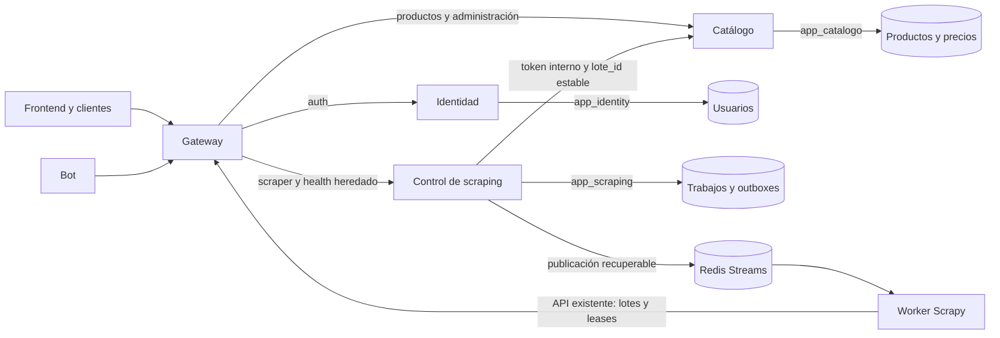

# SUP-273: Control de scraping independiente

Parte del squash aprobado de SUP-272, `45aed821` (PR #99), en
`develop-refactor`. La rama es
`backend/refactor/sup-273-extraer-coordinacion-scraping-vmatus`.

El último dominio de `backend/api` pasa a `backend/control_scraping` con módulo,
binario, imagen, Deployment, Service y HPA propios. Se retira el servidor heredado,
sus modelos globales y su Dockerfile. La herramienta de semillas se conserva en
`backend/catalogo/cmd/seed_productos`; no se ejecuta al arrancar un servicio.



Gateway no accede a SQL ni contiene reglas de negocio. No se crea una biblioteca
compartida de dominios. Control no importa Identidad/Catálogo y no persiste
productos o precios. El worker no recibe credenciales PostgreSQL. IA y rutas
quedan fuera de esta refactorización.

## Contratos y enrutamiento

| Ruta | Método | Propietario |
|---|---|---|
| `/api/v1/scraper/trabajos` | POST | Control, crea trabajo |
| `/api/v1/scraper/trabajos/{id}` | GET | Control, consulta estado |
| `/api/v1/scraper/trabajos/{id}/ejecutar` | POST | Control, outbox de ejecución y Redis |
| `/api/v1/scraper/trabajos/{id}/finalizar` | PUT | Control, conserva validaciones y contador |
| `/api/v1/scraper/trabajos/{id}/productos` | POST | Control, entrega durable a Catálogo |
| `/api/v1/scraper/productos` | POST | Control, ingesta directa idempotente |
| `/health`, `/api/v1/health` | GET | Control, JSON heredado compatible |
| `/swagger/*`, `/` | GET | Control, documentación de coordinación y raíz compatible |
| `/api/v1/auth/*` | existentes | Identidad |
| `/api/v1/productos/*`, `/api/v1/admin/productos/*` | existentes | Catálogo |

No cambian los estados, códigos de negocio, headers de lease, Idempotency-Key,
cookies ni formatos de lote. La clave de lote y los namespaces Redis existentes
se conservan. No hay migración de datos, cambio de cola ni vaciado de spools.

Gateway usa `SCRAPING_URL=http://control-scraping:8080`. En el despliegue normal
no necesita `BACKEND_URL` ni un servidor API residual. Sólo enruta prefijos
delimitados: `scrapertools` no pertenece a scraping. Los probes privados
`/_scraping/live` y `/_scraping/ready` devuelven 404 desde Gateway.

Un fallo de Control devuelve `scraping_unavailable` (502) o `scraping_timeout`
(504), sin fallback ni reintento automático de una escritura. Identidad,
Catálogo y readiness local de Gateway siguen atendiendo. `/_gateway/dependencies`
añade `scraping`, `scraping_database`, `scraping_redis`; mantiene los alias de
diagnóstico `backend`, `database`, `redis` por compatibilidad.

`BACKEND_URL` queda como modo legado explícito para imágenes aprobadas anteriores.
Los overrides históricos desactivan `SCRAPING_URL` y restauran los probes y
credenciales que necesita cada imagen. No mezclar la imagen nueva con probes
antiguos durante un rollback sin comprobar el destino.

## Datos, seguridad y ciclo de vida

Control recibe sólo `SCRAPING_DB_URL` con `app_scraping`, contraseña y base
explícitas. No hay fallback a DB_URL/administrador. Conserva un pool de 5
conexiones, 2 idle y vida de 30 minutos. Usa únicamente las tablas de trabajos
y outboxes autorizadas por SUP-271. El seeder pertenece a Catálogo y requiere
DB_URL explícito; sus permisos operativos no se añaden a Control.

Control no recibe JWT_SECRET, GOOGLE_CLIENT_ID ni DSN de Identidad. Su token
interno de Catálogo debe tener al menos 32 caracteres. Catálogo sigue validando
que ese token sea distinto de su clave JWT; un token equivocado se rechaza en
la ingesta privada. No se emiten ni validan sesiones en Control.

Se conservan las correcciones de SUP-270: SQL antes de publicación recuperable,
leases/reintentos, deduplicación de Redis, cierre terminal y recuperación de
entregas con clave estable. Varios procesos usan el mismo outbox durable y sus
claims SQL; confirmar un lote incrementa el contador una sola vez. El worker
mantiene su volumen/spool y sus límites actuales; escalar Control no escala al
worker ni permite compartir su SQLite entre workers.

`REDIS_URL` es obligatorio y debe ser una URL válida. No hay fallback silencioso
a localhost. Su caída de red no impide arrancar ni retira readiness si SQL sigue
sano: el trabajo puede permanecer durable hasta que se recupere Redis.

CORS usa `SCRAPING_CORS_ALLOWED_ORIGINS`, con orígenes HTTP(S) exactos. Rechaza un
Origin ajeno antes de ejecutar handlers y conserva Idempotency-Key en preflight.
Vacío admite clientes sin Origin y bloquea navegadores de otros sitios.

Todas las rutas `/api/v1/scraper/*` exigen `Authorization: Bearer
<SCRAPING_SERVICE_TOKEN>`. Gateway es público (por `api-ingress` y por
`frontend-ingress` en `/api/v1`), así que sin este token cualquiera podía crear
trabajos, lanzar spiders, cerrar trabajos ajenos o inyectar precios que Control
entrega a Catálogo con su token interno. Sus únicos clientes son el worker y el
bot; el frontend no consume estas rutas. Control compara hashes SHA-256 en
tiempo constante, responde 401 con `WWW-Authenticate` y no arranca si el token
está vacío, tiene menos de 32 caracteres, contiene espacios o coincide con
`CATALOGO_INTERNAL_TOKEN`. Probes y Swagger no lo exigen. El worker (incluidos
los procesos Scrapy que lanza) y el bot leen el mismo `SCRAPING_SERVICE_TOKEN`.
Permisos por usuario y cuotas siguen fuera de alcance.

Errores internos, panics y errores del contexto devuelven 500 genérico, sin
trazas SQL. Se registran localmente con slog y X-Request-ID; los logs HTTP usan
ruta de plantilla y omiten cuerpos, cookies y claves. El cuerpo máximo sigue
en 8 MiB, compatible con Catálogo. Contexto de petición 65 s, read-header 5 s,
read 30 s, write 70 s, idle 60 s y cabeceras 64 KiB. Gateway conserva su propio
presupuesto menor; una cancelación no elimina el outbox durable.

Startup verifica tablas/grants una vez, con 5 s de presupuesto. Liveness no
consulta SQL/Redis; readiness comprueba SQL y diagnostica Redis, con 2 s de
presupuesto total. Los tres probes Kubernetes son exec por loopback usando
wget de la imagen Alpine. NetworkPolicy mantiene ingreso exclusivo desde pods
Gateway del mismo namespace; requiere un CNI que aplique esas políticas.

El binario corre como 65532:65532, con filesystem de sólo lectura, sin
capabilities ni privilegios. SIGTERM primero drena HTTP, cancela los dos loops,
espera su terminación y cierra el publisher/pools. El presupuesto es de 15 s;
Compose/Kubernetes dan 20 s para terminar. Un fallo de arranque sale con código
no cero, en vez de aparentar una ejecución correcta.

## Despliegue y escalado

Compose usa el servicio `control_scraping`, alias DNS `control-scraping`, sin
puerto público propio. Bot/worker conservan `http://api:8080`, alias de Gateway.
En Kubernetes, `Service/api` también conserva ese nombre y selecciona Gateway;
su manifiesto pasa a `infrastructure/k8s/gateway/api-service.yaml`.

Control: request 100m CPU/64Mi, límite 500m/256Mi, HPA 1–4 réplicas y objetivo
CPU 70%. Con Identidad y Control a cinco conexiones y Catálogo a diez,
los HPA al máximo suman `4*5 + 4*5 + 4*10 = 80` conexiones runtime. No es una
medición de capacidad de PostgreSQL; hay que contar clientes administrativos.
Gateway no tiene pool SQL. Las réplicas del worker conservan su política propia.

Orden de corte para el operador:

1. Registrar imágenes inmutables aprobadas, comprobar roles/grants de SUP-271,
   Secrets existentes y orígenes reales del frontend. Provisionar el Secret
   `scraping-service-secret` (clave `token`) antes del rollout: Control, worker
   y bot lo referencian y no arrancan sin él. Igual que `catalogo-internal-secret`,
   no se versiona; crearlo desde un archivo privado
   (`kubectl create secret generic scraping-service-secret --from-file=token=<archivo>`)
   con un valor de `openssl rand -hex 32` distinto del token interno de Catálogo.
   Desplegar Control junto con worker y bot: una versión sin token recibe 401.
2. Aplicar los manifiestos de Control y verificar readiness, permisos y conectividad
   interna desde Gateway. Conservar temporalmente API SUP-272 durante este paso.
3. Actualizar Gateway con SCRAPING_URL y retirar BACKEND_URL. Verificar el flujo
   completo bot/worker → Gateway → Control → Catálogo y la confirmación final.
4. Mantener sesiones de Identidad/Catálogo, probar independencia de fallos y
   escalado de Control. No cambiar claves, colas, lotes activos ni spools.
5. Retirar Deployment/api, HPA/api-hpa y Service/api-backend sólo después de
   validar el corte. **No retirar Service/api**: sigue siendo alias de Gateway.

## Rollback a SUP-272

En Compose, usar una imagen de API SUP-272 aprobada e inmutable:

```bash
export SUP273_LEGACY_API_IMAGE='ghcr.io/danirc2024/taller_integracion_iii-api@sha256:<digest-aprobado>'
docker compose --env-file .env -f docker-compose.yml -f docker-compose.scraping-rollback.yml \
  up -d --no-deps control_scraping gateway
```

El override restaura el probe `/health`, desactiva SCRAPING_URL y apunta
BACKEND_URL al proceso histórico. Conserva sólo el DSN de coordinación, el
token interno y los servicios independientes de Identidad/Catálogo. No vuelve
al monolito previo a esas extracciones.

En Kubernetes, primero restaurar una imagen aprobada SUP-272 bajo el Deployment
de Control, conservando app:control-scraping y sus Secrets. Cambiar startup y
liveness exec a `/_api/live`, y readiness exec a `/health`; la imagen histórica
no tiene `/_scraping/*`. Una vez Ready, configurar Gateway con SCRAPING_URL vacío
y BACKEND_URL apuntando al mismo Service/control-scraping. Mantener IDENTIDAD_URL
y CATALOGO_URL. Para volver al corte nuevo, restaurar imagen/probes nuevos y luego
SCRAPING_URL. No hay rollback SQL ni ampliación de permisos.

La imagen histórica también restaura su CORS/errores heredados. Este rollback
es contingencia temporal; no trasladar esas debilidades al servicio nuevo.

## Validación

```bash
cd backend/control_scraping
go test -race ./...
go vet ./...
go build ./cmd/control_scraping
swag init --parseInternal -g cmd/control_scraping/main.go
```

Desde la raíz, `bash scripts/smoke_control_scraping_compose.sh` crea un proyecto
Compose efímero con DB, Redis y credenciales privadas. Ejecuta los humos de
Identidad, Catálogo, permisos, ingesta y recuperación existentes, más:

- Probes exactos del Deployment en runtime, caída SQL/Redis y recuperación.
- Shutdown limpio, aislamiento de fallos y rutas privadas inaccesibles por Gateway.
- Tres réplicas de Control, dieciocho entregas del mismo lote distribuidas entre
  las tres por puertos locales efímeros y confirmación final por Gateway: una
  captura, un incremento y ninguna recreación de Identidad/Catálogo/Gateway.
- Rollback a API SUP-272 y vuelta sin cambiar tablas/outboxes o sesiones.
- CORS por allowlist, imagen no root/read-only y ausencia de secretos de Identidad.

Los puertos fijos heredados de Gateway/frontend/fixtures requieren ejecutar
un solo harness a la vez. Los recursos de prueba se retiran al terminar; no
se ejecuta scraping externo ni se toca el clúster universitario.
Los resultados efectivos y límites se registran en SEGUIMIENTO_REFACTOR_BACKEND.md.
