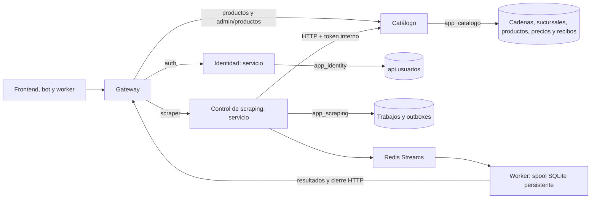

# Propiedad de datos y permisos del backend

Define qué rol de PostgreSQL usa cada servicio y sobre qué tablas puede operar.
Se introdujo en SUP-271 (PR #97 y siguientes). La regla de fondo está en
[D02](../Decisiones/02_PostgreSQL_unico_con_roles.md).

## Arquitectura vigente



Los tres grupos de tablas siguen en PostgreSQL/PostGIS. `api` y `scraper` son
nombres físicos heredados; `scraper` contiene tanto tablas de Catálogo como de
coordinación. Un esquema no equivale automáticamente a un servicio. No se copian
datos ni se introducen vistas compartidas, joins externos o entidades comunes.

Identidad, Catálogo y Control tienen proceso, imagen, Deployment y HPA propios.
La API heredada se retiró en SUP-273. Cada uno recibe sólo su credencial SQL;
no comparten entidades ni una biblioteca de dominios. Catálogo sigue separado.

## Matriz de runtime

| Propietario / rol | Tablas | Permisos |
| --- | --- | --- |
| Identidad / `app_identity` | `api.usuarios`, `api.tokens_recuperacion` (SUP-184) | SELECT, INSERT, UPDATE |
| Coordinación / `app_scraping` | `scraper.trabajos_scraper`, `scraper.entregas_ingesta`, `scraper.entregas_trabajos` | SELECT, INSERT, UPDATE; DELETE sólo en `entregas_trabajos` |
| Catálogo / `app_catalogo` | `scraper.productos_crudos` | SELECT, INSERT, UPDATE |
| Catálogo / `app_catalogo` | `scraper.cadenas_supermercado` | SELECT, INSERT; UPDATE sólo columna `esta_activa` |
| Catálogo / `app_catalogo` | `scraper.sucursales_supermercado`, `scraper.capturas_precios`, `scraper.lotes_catalogo` | SELECT, INSERT |
| Motor de rutas / `app_rutas` | `rutas.listas_compras` | SELECT, INSERT, UPDATE, DELETE |
| Motor de rutas / `app_rutas` | `rutas.articulos_lista_compras` | SELECT (escritura con SUP-241) |
| Gateway y worker | Ninguna tabla PostgreSQL | Sin credencial PostgreSQL |

Sólo Catálogo necesita USAGE en las secuencias de cadenas, sucursales y capturas.
El UPDATE de `scraper.cadenas_supermercado` se concede a nivel de la columna
`esta_activa`, que administra el panel de fuentes (SUP-243); no se otorga UPDATE
de tabla completa. Se aplica en `06_propiedad_permisos.sql` y
`08_grants_catalogo_fuentes.sql` reaplica el mismo GRANT de forma idempotente en
bases ya migradas, retirando primero cualquier grant de tabla anterior.
Las capturas y recibos son append-only para el runtime. Sólo `app_scraping` puede
borrar del outbox `scraper.entregas_trabajos` para purgar ejecuciones terminales,
como exige SUP-270. No puede borrar trabajos ni entregas de ingesta. Ningún rol
puede truncar, crear tablas, administrar roles, heredar membresías o migrar el esquema.
La desactivación de un usuario usa UPDATE, no DELETE. Retención y borrado requieren
un procedimiento del operador; no se añaden grants para tareas aún inexistentes.

Los nombres `app_identity`, `app_scraping` y `app_catalogo` quedan reservados
para esta aplicación y son globales al clúster PostgreSQL. Se crean NOLOGIN,
NOINHERIT y sin privilegios de administrador; provisionar la contraseña activa
LOGIN. La migración conserva contraseñas existentes al repetirse. Los objetos
siguen perteneciendo al operador de migraciones, no a estos roles.

El resto de `api.*` (preferencias, perfiles, tarjetas, misiones, catálogo
normalizado, equivalencias, recetas y mapeos IA) queda fuera del runtime
implementado. Se conserva con el operador hasta definir sus servicios y
contratos. No se modifica IA conversacional ni se conceden permisos preventivos.

SUP-240 asigna las listas de `rutas.*` al motor de rutas (`backend/motor_rutas`),
como documenta su [README](../../backend/motor_rutas/README.md). `app_rutas` sigue las mismas reglas que los otros tres
roles: NOLOGIN hasta provisionar contraseña (`RUTAS_DB_PASSWORD` o `\password`),
sin herencia ni objetos propios. Sólo DELETE en `listas_compras`: borrar una
lista elimina sus artículos por la FK interna, que PostgreSQL ejecuta como dueño
de la tabla. Ejecuciones, paradas y detalle siguen sin grants hasta que exista
la optimización.

## Referencias entre dominios

- `trabajos_scraper.cadena_id` conserva el ID devuelto por Catálogo mediante
  HTTP al iniciar el trabajo. `cadena_nombre` almacena el nombre en ese momento.
  La migración rellena el nombre de trabajos históricos que conservan su cadena.
  Consultar y finalizar un trabajo usa ese snapshot; sólo un snapshot vacío
  conserva la consulta HTTP auxiliar para compatibilidad histórica.
- `disparado_por_usuario_id` conserva un UUID de auditoría. No acredita sesión,
  existencia actual del usuario ni autorización; las rutas de scraping mantienen
  su contrato actual. No debe usarse para conceder permisos. Una futura ruta
  autenticada debe tomar el actor del JWT validado, no confiar en un UUID del body.
- Se eliminan sólo las FK desde trabajos hacia cadenas y usuarios. Eliminar esos
  registros mediante un operador ya no elimina trabajos ni modifica el actor.
  Se conservan FK internas de Catálogo y de entregas hacia sus propios trabajos.
- Los `cadena_id`/`sucursal_id` de las entregas permanecen referencias/snapshots
  resueltos por HTTP, sin transacción ni joins SQL con Catálogo. Una referencia
  cuyo destino desapareció sigue el manejo de fallos de SUP-270.

- `listas_compras.usuario_id` es el `user_id` del JWT de Identidad. SUP-240
  elimina su FK hacia `api.usuarios`: borrar un usuario ya no borra sus listas
  en cascada, y el motor de rutas nunca lee `api.*`.

Las FK de IA y del resto de `rutas.*` (artículos hacia productos normalizados,
ejecuciones y paradas hacia perfiles, sucursales y capturas) se revisan con la
tarea que las use (SUP-241, SUP-244). Evitar crear nuevas dependencias de
runtime hacia ellas.

## Configuración

Desde SUP-272, Identidad requiere `IDENTITY_DB_URL` con usuario `app_identity`
y API sólo `SCRAPING_DB_URL` con `app_scraping`, base y contraseña explícitos.
No hay fallback a DB_URL/administrador. Los errores no incluyen el DSN.
Cada proceso dispone de un pool con máximo 5 conexiones, 2 inactivas y vida
máxima de 30 minutos. Cada uno verifica sólo sus tablas/grants al arrancar.
`/health` y `/api/v1/health` de API conservan `checks.database` y
`checks.scraping_database`; ya no comprueban Identidad. Responden 503 si falla
SQL y tienen un presupuesto de 2 s. Redis es diagnóstico de coordinación,
porque el outbox SQL acepta ejecuciones durante su caída.
Identidad usa `/_identidad/ready` con Ping SQL y Redis; login falla cerrado sin
Redis. Su liveness es independiente, y no repite verificaciones de permisos.

El liveness de Kubernetes usa `/_api/live`, que responde sin consultar PostgreSQL
ni Redis. Readiness sigue usando `/health`: una caída de DB retira el endpoint
sin reiniciar un proceso que continúa respondiendo. Compose usa `/health` como
healthcheck; marcar un contenedor unhealthy no lo reinicia automáticamente.

Catálogo sigue usando `DB_URL`, inyectado exclusivamente con `app_catalogo`.
Antes de abrir HTTP valida una sola vez sus tablas y permisos, con timeout de
5 s (15 consultas en modo escritor, 5 en modo lector). Si faltan permisos,
migración o conectividad al iniciar, termina con un diagnóstico controlado:
no puede aceptar tráfico sólo porque un Ping funcione. No ejecuta AutoMigrate.
Después de arrancar, `/_catalogo/ready` sólo hace `PingContext` (presupuesto 2 s)
y `/_catalogo/live` no consulta SQL. Si DB cae y vuelve, el mismo proceso recupera
readiness. Cambios posteriores de permisos/tablas requieren un rollout/reinicio
para volver a validar storage; los probes periódicos no auditan privilegios.

Los HPA de Identidad, API y Catálogo permiten hasta cuatro réplicas por servicio.
El techo de los pools es `4 × 5 + 4 × 5 + 4 × 10 = 80` conexiones; el motor de
rutas suma `2 × 5 = 10` (HPA máximo 2, `RUTAS_DB_POOL_MAX=5`). Contar además
operadores, migraciones, bot/IA/rutas y otros consumidores: 80 es un máximo
configurado, no un consumo medido ni una garantía de capacidad. Si cambian HPA
o pools, recalcular antes de desplegar.

Esta corrección no aumenta `max_connections` ni los recursos del pod DB. Sus
300 MiB de límite de memoria deben contrastarse con carga real de PostGIS y
cuotas de la universidad antes de aumentar concurrencia. Elevar el máximo a
200 no aporta capacidad de memoria por sí solo. El Keep-Alive del cliente interno
sigue como mejora posterior de SUP-269; conservar en esa mejora la idempotencia,
los timeouts y el control de reintentos de escrituras.

Compose recibe `IDENTITY_DB_PASSWORD`, `SCRAPING_DB_PASSWORD` y
`CATALOGO_DB_PASSWORD` por `.env` privado. Generar cada valor por separado con
`openssl rand -hex 32`; no reutilizar el de PostgreSQL administrador. El formato
hexadecimal permite construir las URL sin caracteres que necesiten escape.
Sólo DB recibe las tres contraseñas para inicializar roles; Identidad y API reciben sus
URL exclusivas y Catálogo la suya. Gateway/worker no reciben estos valores.

Kubernetes requiere tres Secrets privados, cada uno con claves `DB_URL` y
`DB_PASSWORD` consistentes: `identity-db-secret`, `scraping-db-secret` y
`catalogo-db-secret`. El pod DB usa DB_PASSWORD para inicialización; cada runtime
recibe únicamente las URL que utiliza. No hay valores reales ni contraseñas de
ejemplo nuevas en Git. Crear los Secrets con el procedimiento del equipo o
`kubectl create secret generic <nombre> --from-env-file=<archivo-privado>`.
Las URL deben apuntar al Service DB/base reales y mantener la política TLS del
entorno. No imprimir Secrets ni usar `docker compose config` sin `--quiet` al
diagnosticar credenciales.

## Migraciones

`06_propiedad_permisos.sql` es la fuente única de roles y grants, y es
idempotente: en una base existente se vuelve a ejecutar como operador. El orden
de los scripts y cuáles aplicar a mano están en el
[README de `infrastructure/db`](../../infrastructure/db/README.md). La matriz de
`backend/control_scraping/tests/smoke_data_ownership.py` debe actualizarse junto
con la de `06`.

## Validación

```bash
bash scripts/smoke_data_ownership_compose.sh
```

El harness usa los scripts de migración/credenciales reales y roles dedicados,
sin grants alternativos escritos sólo para tests. Comprueba acceso TCP positivo
y denegaciones reales sobre tablas de los tres esquemas, DELETE/TRUNCATE/DDL,
SET ROLE, secuencias y tablas futuras. Repite la migración, preserva contraseñas,
rechaza membresías/permisos públicos (también grants por columna) y verifica trabajos históricos después de
eliminar cadena/usuario, incluso con Catálogo detenido. 

La validación usa bases, redes y volúmenes temporales. No modifica PostgreSQL
local del usuario ni el clúster universitario. La aplicación de la migración,
Secret/ConfigMap y el rollback de credenciales en el clúster requieren validación
del operador durante despliegue; este trabajo no los ejecuta.
