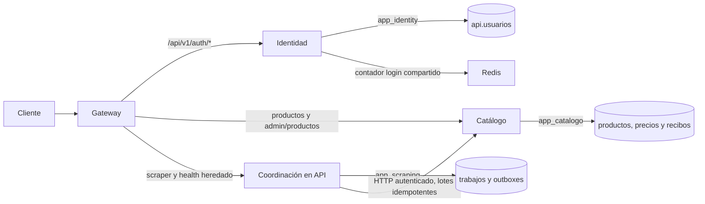

# SUP-272: Identidad como servicio independiente

SUP-272 parte de `develop-refactor`, después de integrar SUP-271 por squash
`49770b3` (PR #98). No migra usuarios ni cambia su esquema. Extrae el código de
Identidad de `backend/api/internal/identity` a `backend/identidad`, con módulo
Go, binario, imagen, pruebas y despliegue propios. Coordinación de scraping
continúa en `backend/api` hasta SUP-273.

## Contratos conservados

| Ruta pública | Método | Propietario después del corte |
|---|---|---|
| `/api/v1/auth/register` | POST | Identidad, registro con auto-login existente |
| `/api/v1/auth/login` | POST | Identidad, login local y límite Redis |
| `/api/v1/auth/google` | POST | Identidad, validación criptográfica de Google |
| `/api/v1/auth/me` | GET | Identidad, claims de sesión |
| `/api/v1/auth/me` | PUT | Identidad, actualización del usuario de la sesión |
| `/health`, `/api/v1/health` | GET | API, sólo conexión SQL de coordinación y diagnóstico Redis |
| `/swagger/*` | GET | API, documentación de sus rutas de coordinación y salud |

La API ya no registra auth: llamarla directamente devuelve 404. Gateway conserva
ruta, query, cuerpo, cookie y `Set-Cookie`; sanitiza los headers de identidad y
no hace fallback cuando Identidad falla. Un fallo de conexión produce
`identidad_unavailable` (502); un timeout produce `identidad_timeout` (504).
Las rutas desconocidas dentro de `/api/v1/auth/` siguen perteneciendo a Identidad;
los prefijos parecidos, como `/api/v1/authentication`, no se enrutan allí.
Los probes de Identidad son internos y no se reenvían por la entrada pública.

Swagger de API se regenera con `swag init --parseInternal` en `backend/api`.
Ya no publica operaciones de Identidad o Catálogo que ese contenedor devuelve
como 404. Gateway sigue sirviendo esa UI por `/swagger/*`, con el mismo alcance
de coordinación; las cinco rutas auth públicas siguen funcionando por Gateway
y están descritas arriba. Esta especificación no es un agregador de servicios.

Los JWT mantienen HS256, `user_id`, `rol`, `provider` y expiración de 24 horas.
Las cookies conservan nombre `jwt`, HttpOnly, Path `/` y duración. Se explicita
SameSite=Lax y Secure=true por defecto; Compose local HTTP lo desactiva mediante
configuración. Catálogo sigue validando firma y rol por su cuenta, sin consultar
usuarios ni importar código de Identidad. Conservar la misma clave al hacer el
corte permite reutilizar sesiones anteriores.

Esta tarea extrae las cinco rutas existentes. No implementa refresh tokens,
revocación, verificación de correo, recuperación de contraseña ni nuevas reglas
Premium. El auto-login del registro y su mensaje sobre verificación se conservan
como comportamiento previo; no se presentan como una verificación ya implementada.

## Configuración y permisos

| Variable de Identidad | Requisito |
|---|---|
| `IDENTITY_DB_URL` | DSN con `app_identity`, base y contraseña explícitos; sin fallback a administrador/DB_URL |
| `JWT_SECRET` | Misma clave de Catálogo, al menos 32 bytes; no existe clave local de respaldo |
| `REDIS_URL` | Obligatorio; URL validada sin exponer secretos |
| `GOOGLE_CLIENT_ID` | Audience del cliente Google existente; vacío conserva login local y deshabilita SSO |
| `CORS_ALLOWED_ORIGINS` | Orígenes HTTP(S) exactos del frontend, separados por comas; sin comodines |
| `IDENTIDAD_COOKIE_SECURE` | true por defecto; false sólo para HTTP local explícito |
| `IDENTIDAD_TRUSTED_PROXIES` | IPs/CIDRs reales de Gateway, obligatorio; vacío invalida el arranque |
| `PORT` | 8080 por defecto |

La API sólo recibe `SCRAPING_DB_URL`; ya no recibe credencial de Identidad ni
configuración Google. Su `JWT_SECRET` se conserva temporalmente para comprobar
que el token interno de Catálogo sea distinto; no contiene emisor/verificador
JWT ni rutas auth. Identidad no recibe claves de coordinación o ingesta.
Los roles y Secrets separados provienen de SUP-271: no hay nueva migración SQL.
Cada proceso de Identidad y API dispone de un pool de máximo 5 conexiones,
2 idle y vida de 30 minutos. Con HPA máximo de 4 por dominio y Catálogo a 10,
el presupuesto runtime sigue en `4*5 + 4*5 + 4*10 = 80`. Otros clientes y sesiones
administrativas consumen conexiones adicionales; revisar capacidad real de DB.

Si la clave JWT actual tiene menos de 32 bytes, planificar su actualización en
Identidad y Catálogo conjuntamente: rotarla invalida las cookies anteriores.
No cambiarla sólo para un servicio ni afirmar que esa rotación conserva sesiones.

## IP real y protección del login

Gateway normaliza X-Forwarded-For usando su algoritmo de sufijo confiable.
Configurar también `GATEWAY_TRUSTED_PROXIES` con las IPs/CIDRs reales de
Nginx/Ingress: si se omiten, los clientes del frontend comparten la IP de Nginx
antes de llegar a Identidad. El harness configura sólo su Nginx real y prueba
login a través del frontend, incluida una cadena malformada antepuesta.
Identidad sólo lo interpreta si la conexión proviene de un proxy configurado;
ignora X-Real-IP. No acepta `X-User-ID`, `X-Role` ni `X-User-Role` como sesión.

Compose usa una red de entrada dedicada `identidad_edge`. Gateway tiene IP
`IDENTIDAD_GATEWAY_IP` (172.30.0.2 por defecto), y se comunica por el alias
`identidad-upstream`, exclusivo de esa red. El rango dinámico de Identidad
(`IDENTIDAD_EDGE_RANGE`, 172.30.0.128/25) excluye la IP de Gateway; el subnet
(`IDENTIDAD_EDGE_SUBNET`, 172.30.0.0/24) debe contener ambos. Al cambiarlo,
actualizar las tres variables consistentemente y comprobar que no se solape con
otras redes Docker. Confiar en la IP de Gateway y usar el alias correcto evita
que todos los clientes compartan el contador de la IP del proxy.

En Kubernetes se configura el CIDR/IP real de los pods Gateway y se añade una
NetworkPolicy que admite entrada HTTP sólo desde pods `app: gateway` del mismo
namespace. Requiere un CNI que aplique NetworkPolicy. Kubernetes necesita ese
conocimiento de red antes del corte: el campo vacío invalida el arranque,
para impedir que los clientes terminen agregados por IP de Gateway.
No configurar `0.0.0.0/0` ni toda la red sin ese aislamiento de entrada.

El contador conserva `rate_limit:login:<IP>` y la ventana de 5 intentos cada
15 minutos, pero sólo cuentan los intentos fallidos: el intento se incrementa
antes del handler (atómico bajo concurrencia) y una respuesta 2xx lo devuelve.
Así varios usuarios legítimos tras un mismo NAT (Wi-Fi de la universidad, una
demo en clase) no se bloquean por iniciar sesión correctamente. Registro
(`rate_limit:register:<IP>`) y Google (`rate_limit:google:<IP>`) también tienen
límite: 30 peticiones por IP cada 15 minutos, contando todas, porque bcrypt
cuesta CPU y el 409 del registro permite enumerar correos. Igual que el login,
fallan cerrados con 500 si Redis no responde.
Un script Lua realiza INCR y expiración juntos, y repara TTL ausente.
Las réplicas comparten la ventana. Redis debe permitir EVAL/EVALSHA e INCR,
PTTL y PEXPIRE para ese namespace. Si Redis falla, login permanece cerrado
con 500 genérico; no se ejecutan comprobaciones de contraseña sin límite.
Los comandos respetan un presupuesto de 1 segundo y no reintentan escrituras.

## Seguridad y observabilidad

- CORS rechaza orígenes ajenos antes de ejecutar handlers; conserva preflight y
  credenciales únicamente para la allowlist. Respuestas varían por Origin.
- JWT acepta sólo HS256, requiere expiración y claims de identidad completos,
  y no acepta firma inválida, token expirado, nbf futuro o clave ausente.
- Se conserva la comprobación de PasswordHash nil/vacío para usuarios SSO.
- Google conserva el validador criptográfico oficial y audience; se exige issuer
  de Google, email verificado y subject. Claims opcionales no causan panic;
  cuentas inactivas o vinculadas a otro subject no obtienen sesión.
- Vinculación con Google (medida provisoria hasta implementar la confirmación
  de correo): el registro local aún no verifica el correo, así que alguien podría
  pre-registrar el correo de otra persona. Por eso, el primer login con Google
  sobre una cuenta local sin `google_id` guarda el subject e invalida
  `password_hash`. Cuando exista la verificación de correo, la contraseña debe
  conservarse si el correo local estaba verificado y ambos métodos convivirán.
- `PUT /auth/me` exige `current_password` para cambiar `correo` o `password`
  (403 si falta o no coincide); nombre, teléfono y dirección no la requieren.
  Las cuentas sin contraseña local (Google) no pueden cambiar correo ni definir
  contraseña por esta vía hasta que exista la confirmación por correo.
- El registro ya no devuelve `token_verificacion` al cliente: cuando exista la
  verificación de correo, ese token sólo debe viajar por correo.
  Avatares opcionales con UTF-8 inválido o más de 500 caracteres se omiten;
  no se corta una URL ni se bloquea el login por ese dato opcional.
- Conflictos únicos en PostgreSQL se traducen a conflicto de correo; carreras de
  registro no devuelven errores internos. SSO concurrente vuelve a leer la cuenta
  y verifica su asociación antes de aceptarla.
- Errores internos y panics no incluyen trazas/SQL en el JSON. `detalle` se
  limita a validación HTTP 400. Google distingue token rechazado (401),
  configuración ausente (503) y fallo de persistencia (500). Se conservan mensajes
  públicos y el envoltorio `estado/mensaje`; diagnósticos se registran localmente.
- Se propaga/genera X-Request-ID y se registran ruta de plantilla, método, código
  y duración, sin cuerpos ni cookies. Hay límite de cuerpo de 64 KiB, contexto
  de petición de 10 s, Google de 5 s y límites HTTP de cabeceras/lectura/escritura.
- Contraseñas de más de 72 bytes se rechazan como validación antes de bcrypt.
- Nombres vacíos tras sanitizar se rechazan con 400 en registro y actualización,
  antes de persistir. El límite es de 100 caracteres Unicode, sin cortar tildes
  o ñ; la expresión regular se compila una vez y admite uso concurrente.

HS256 mantiene una clave compartida con Catálogo por compatibilidad. Una
migración futura a firma asimétrica requerirá despliegue coordinado y pruebas de
rotación. JWT ya emitidos no se revocan al cambiar contraseña/desactivar cuenta;
esa deuda es previa y pertenece al trabajo de revocación. Register/Google no
incorporan una nueva cuota por IP en esta extracción; revisar ese hardening aparte.
Las rutas de scraping mantienen su política de acceso y errores heredados hasta
su propia tarea; no se cambia el contrato del bot/worker en SUP-272.

## Salud y disponibilidad

Al arrancar, Identidad valida una vez conectividad y SELECT/INSERT/UPDATE de
`api.usuarios`, antes de abrir HTTP, con presupuesto de 5 s. Faltas de tablas,
permisos o DSN invalidan el arranque. No hace AutoMigrate.

`/_identidad/live` responde sin consultar SQL ni Redis. `/_identidad/ready`
comparte un presupuesto de 2 s para Ping SQL y Redis, sin repetir consultas de
permisos. Ambos son requisitos de disponibilidad del login. Una caída posterior
no reinicia el proceso por liveness; las conexiones recuperan readiness cuando
las dependencias vuelven. Cambiar grants después exige rollout para reauditarlos.

Los tres probes Kubernetes son `exec`: BusyBox `wget`, incluido en Alpine,
consulta HTTP en `127.0.0.1` dentro del contenedor. Startup/liveness consultan
`live` con timeout de 1 s y readiness consulta `ready` con timeout de 2 s;
los presupuestos kubelet siguen en 2/2/3 s. No requieren shell, privilegios,
escritura ni otra imagen. La NetworkPolicy continúa admitiendo únicamente
pods Gateway del mismo namespace en 8080; no se abre ese puerto al namespace
completo ni se agregan CIDRs de nodos que también habilitarían rutas auth.

El contrato estándar de NetworkPolicy exceptúa el tráfico del nodo local del
pod; el DROP descrito en H-01 no es inevitable por esa política Kubernetes
sola. Políticas de host adicionales y comportamiento del CNI deben comprobarse
en el clúster. Ejecutar los probes por loopback elimina esa dependencia de
ingress host → pod. Referencia normativa:
https://kubernetes.io/docs/concepts/services-networking/network-policies/

Gateway mantiene readiness local. `/_gateway/dependencies` diagnostica los tres
upstreams y sus dependencias, pero no retira rutas sanas porque otro dominio
falle. Catálogo puede validar cookies existentes aun con Identidad detenida.

## Corte y rollback

1. Verificar los roles, datos y Secrets existentes de SUP-271 y la misma clave
   JWT de Identidad/Catálogo. Registrar imágenes inmutables aprobadas; no depender
   de tags móviles para un rollback.
2. Configurar allowlist de frontend, Secure según HTTPS, proxies reales y CNI.
   Desplegar Identidad, Service, ConfigMap, HPA y NetworkPolicy; comprobar
   readiness y una sesión directamente por una ruta interna autorizada.
3. Activar `IDENTIDAD_URL` en Gateway, comprobar las cinco rutas y cookies.
   La API de SUP-271 aún puede permanecer durante ese cambio de enrutamiento.
4. Actualizar API a SUP-272 y retirar IDENTITY_DB_URL/GOOGLE_CLIENT_ID de su
   Deployment. Verificar que no reinicie ni replique Identidad al escalar API.
5. Comprobar usuarios existentes, cookies anteriores, rol administrativo en
   Catálogo y creación/ejecución de scraping. No borrar datos ni roles.

Para volver a SUP-271, restaurar **primero** su imagen de API con ambos DSN y
verificar su health; después vaciar `IDENTIDAD_URL` en Gateway. Sólo entonces
retirar Identidad. Vaciar la URL con API SUP-272 produciría 404, no un rollback.
`docker-compose.identidad-rollback.yml` muestra los overrides; exige imagen
aprobada de SUP-271. Conserva las otras migraciones y permisos; no usar al
administrador ni ampliar grants. API SUP-271 liveness sigue en `/_api/live`.
No eliminar counters Redis ni rotar JWT durante el retorno.

Los rollbacks históricos de Catálogo/ingesta también vacían IDENTIDAD_URL para
que auth vuelva a sus imágenes anteriores. Son procedimientos distintos: no
confundir el rollback específico SUP-272 con volver a un escritor antiguo.

## Validación

`bash scripts/smoke_identity_compose.sh` usa una DB/Redis/red/credenciales
**efímeras**, sin bot, spiders externos ni datos del clúster. Construye las
imágenes y la referencia aprobada SUP-271; conserva las suites de propiedad de
datos, ingesta idempotente, recuperación de trabajo, contratos de Catálogo y
rollback anteriores. Ejecutarlo de uno en uno: el harness heredado tiene puertos
fijos para Gateway/API/frontend; sólo Identidad usa puertos efímeros por réplica.

La suite nueva comprueba sesiones en ambas direcciones, JWT/CORS/IDOR, login
local de una fila SSO real, errores SQL sin filtrado, ocho registros simultáneos,
contadores por cliente, reparación de TTL, spoofing directo y vía Gateway,
Redis caído, cookies Secure, procesos que recuperan sin
reinicio, caída de cada upstream, tres réplicas de Identidad con login concurrente,
permisos ausentes al arranque y rollback a SUP-271 y vuelta.
También ejecuta los comandos exactos del Deployment dentro del contenedor
runtime: startup/liveness conservan éxito cuando Redis o SQL caen, readiness
falla, y los tres recuperan sin reiniciar Identidad. Se comprueba persistencia
real de nombres con tildes/ñ y rechazo 400 sin modificar el perfil existente.
Pruebas Go adicionales usan el validador oficial de Google, RSA y una fixture
JWKS para probar firma, audience, issuer y expiración; no sustituyen un login
real de Google en el navegador ni habilitan TLS inseguro en producción.

El resultado local y sus límites se registran en
`SEGUIMIENTO_REFACTOR_BACKEND.md`. Ninguna prueba despliega el clúster.
