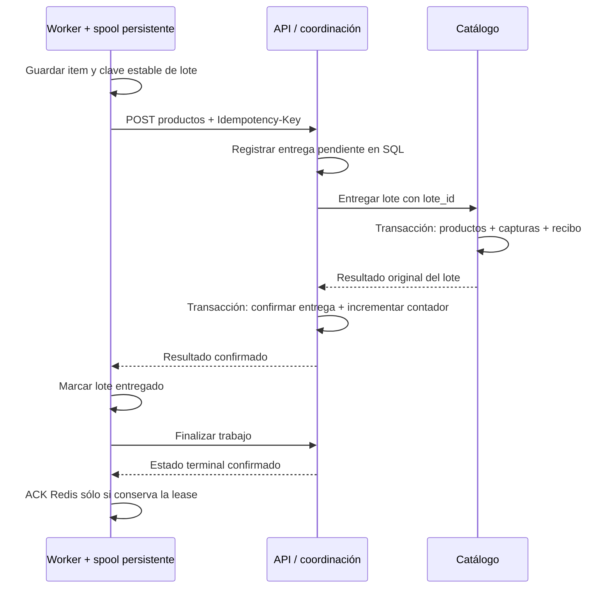

# SUP-270: recuperación de trabajos y entregas de ingesta

Rama `backend/refactor/sup-270-recuperacion-trabajos-ingesta-vmatus`, basada en
SUP-269 ([PR #96](https://github.com/danirc2024/Taller_integracion_III/pull/96)).
Implementación y correcciones de resiliencia del [PR #97](https://github.com/danirc2024/Taller_integracion_III/pull/97).

El objetivo es recuperar una entrega tras perder su respuesta, reiniciar un
proceso o perder los datos de Redis, conservando sus capturas y contadores.
La recuperación no requiere una transacción entre Catálogo y coordinación.



## Propiedad y contratos

| Registro | Propietario | Función |
|---|---|---|
| `scraper.lotes_catalogo` | Catálogo | Clave, hash y resultado confirmados junto con las capturas |
| `scraper.entregas_ingesta` | Coordinación | Payload pendiente, destino resuelto, intentos, lease y resultado |
| `scraper.entregas_trabajos` | Coordinación | Payload de ejecución durable para reconstruir Redis |
| SQLite en `/var/lib/scraper/<UUID>/` | Worker | Items, claves de lote y avance del crawl; no accede a PostgreSQL |

Se mantienen los JSON y rutas de SUP-269. `Idempotency-Key` es un UUID opcional
en los POST públicos de ingesta. Si falta, la API genera uno y lo devuelve en
la cabecera de respuesta; para reintentar con seguridad el cliente debe
conservarlo **antes del primer envío**. El worker nuevo siempre lo conserva.
Sin una clave enviada por el cliente, dos peticiones son dos entregas distintas.

La misma clave y contenido devuelve el resultado original, incluso tras cerrar
el trabajo. Cambiar el contenido o asociarlo a otro trabajo devuelve
`409 idempotency_conflict`. El hash representa el DTO normalizado, incluyendo
la referencia del trabajo; no depende de espacios u orden de claves del JSON.
El destino se fija en la entrega antes de enviar el lote a Catálogo.

Catálogo recibe `lote_id`, sucursal y productos; no recibe `trabajo_id`.
Su recibo se guarda en la misma transacción que productos y capturas. Un
lock transaccional por clave serializa solicitudes entre réplicas. Mantiene
la compatibilidad de lotes internos sin clave para poder volver a SUP-269.

La API confirma entrega y contador en una sola transacción propia. Aunque
dos procesos hayan enviado el mismo lote, el contador se aplica una vez.
Finalizar con `completado` exige que todas las entregas estén confirmadas;
finalizar con `fallido` no espera los backoffs. Las entregas ya registradas
continúan conciliándose por el loop SQL aunque el trabajo haya cerrado como
fallido; así se recupera un commit remoto o contador pendiente. Su contador
puede actualizarse posteriormente. No se admiten lotes nuevos para ese trabajo.
Los contadores de
trabajos con entregas durables no se sustituyen por el número que envíe el
worker. Repetir el mismo estado terminal devuelve 200; cambiarlo devuelve 409.

## Reintentos y fallos

| Situación | Respuesta / recuperación |
|---|---|
| Lote confirmado | 200 con resultado original y cabecera de clave |
| Otro proceso tiene la entrega o aún está en backoff | 202 `entrega_pendiente`, `Retry-After: 2`; todavía no es un recibo |
| Catálogo caído / timeout | 503 / 504; la entrega queda en SQL y el cliente conserva la clave |
| Capturas confirmadas pero falla el contador | 409 `contador_pendiente`, `catalogo_confirmado: true`; el loop recupera el contador reutilizando la clave |
| Destino inválido / clave conflictiva / rechazo 400 | Entrega fallida para revisión, sin reintentar indefinidamente |
| Se agotan 10 intentos de entrega | `fallida`, 409 `entrega_fallida`; se conserva payload y diagnóstico |
| Se intenta completar con entregas pendientes | 409 `entregas_pendientes`, recuperable |
| Se intenta completar con alguna entrega fallida | 409 `entregas_fallidas`, permanente; el worker cierra como fallido |
| Dato inválido / constraint SQL (clases 22 y 23) | Catálogo responde 400 genérico; coordinación marca fallida en el primer intento |

La API recupera una entrega por tick de un segundo. Las réplicas usan
`FOR UPDATE SKIP LOCKED` y lease de 90 s; si un proceso muere, otro puede
reclamarla. Los HTTP internos tienen el límite configurado en SUP-269
(por defecto 10 s, máximo 20 s); cada intento de recuperación tiene 65 s.
El backoff crece exponencialmente desde 2 s hasta 256 s. Se guardan códigos
controlados, sin copiar SQL o secretos a respuestas públicas.

Una entrega fallida requiere corregir su causa y revisar su trabajo. Si sigue
`en_progreso`, un operador puede restablecer esa **misma fila y clave** a
`pendiente`, con `intentos=0`, `proximo_intento=now()` y lease vacía.
No crear otra clave para un lote cuyo resultado remoto sea incierto.
No reactivar automáticamente entregas de trabajos terminales.

## Cola y worker

`POST /trabajos/{id}/ejecutar` registra primero la ejecución en PostgreSQL y
responde 202 sin esperar a Redis. Repetir los mismos parámetros no duplica
la ejecución; cambiarlos en el mismo trabajo devuelve 409.
El publisher recorre trabajos activos cada 5 s, y vuelve a comprobarlos cada
30 s. Usa un cliente Redis sin reintentos implícitos y timeouts de 1 s.
El publisher comprueba SQL sin transacción ni bloqueo de fila y después llama
a Redis. Cada publicación tiene un contexto máximo de 3 s. El ACK instala
atómicamente una marca `scraper:jobs:closed:<UUID>` con TTL de 24 h; Lua comprueba
esta marca antes de publicar, evitando que una lectura anterior al cierre recree
el mensaje tras ACK. La marca vive mucho más que un intento de publicación.
El cierre retira el outbox de ejecución en su transacción SQL; el publisher
también limpia hasta 100 registros terminales antiguos por tick. Una pérdida
completa de Redis elimina las marcas, pero SQL excluye trabajos terminales y
el worker consulta el estado antes de ejecutar cualquier mensaje rezagado.
La aceptación incluye `X-Scraper-Queue: durable-stream`, utilizado para comprobar
que la migración está hablando con la API nueva y no con la versión BRPOP.

La cola nueva es el stream `scraper:jobs:stream`, grupo `scraper-workers`.
La publicación Lua deduplica por trabajo y verifica que su mensaje exista.
Así se reconstruye la cola desde SQL después de perder Redis, incluido su
grupo de consumidores. El worker usa `XREADGROUP`, `XAUTOCLAIM` y ACK explícito.

La lease del worker es 60 s (`SCRAPER_LEASE_MS`, mínimo 10 s). El heartbeat
renueva cada tercio de la lease usando `JUSTID`, sin aumentar el número de
entregas. Renovar y confirmar verifican el propietario atómicamente en Lua:
un consumidor antiguo no puede confirmar el mensaje reclamado por otro.
Si pierde la lease durante el crawl, el worker termina el subproceso Scrapy.
Tras un reinicio espera la expiración de las leases pendientes antes de tomar
trabajos nuevos. Esta prioridad corresponde al despliegue de un único worker
y no es un algoritmo para escalar consumidores independientes.

Antes del HTTP, cada item queda en SQLite con WAL y `synchronous=FULL`.
El worker conserva el documento exacto y UUID de cada lote hasta recibir un
resultado de ingesta consistente. Un 202, un contador pendiente, JSON inválido
o una respuesta vacía no se consideran confirmación.
Tras reiniciar, primero entrega el spool pendiente. Si Scrapy confirmó que
terminó correctamente, sólo repite el cierre; consulta la API para no ejecutar
otra vez un trabajo que ya terminó.

Un crawl interrumpido vuelve a recorrer la fuente, hasta tres intentos. Los
items idénticos del mismo supermercado se deduplican en el spool; un precio
que cambió representa un nuevo dato. No se promete que el HTML de la fuente
se mantenga igual entre intentos. Un crawl con errores de items/spider o
reintentos HTTP agotados no se marca exitoso por tener exit code 0.

Los errores transitorios de API/Redis conservan el mensaje pendiente. Los
tres intentos de crawl agotados o una entrega rechazada requieren confirmar
el fallo en la API antes de hacer ACK y guardar el mensaje en
`scraper:jobs:dead`. Los payloads inválidos de Redis también quedan allí.
El registro SQL de entregas fallidas y el spool conservan el diagnóstico.

## Migración y despliegue

1. Pausar productores y detener el worker anterior de forma controlada.
   Auditar los trabajos `en_progreso`: el BRPOP anterior no dejó un registro de
   mensajes retirados, por lo que un trabajo perdido antes de esta migración
   puede requerir reconstrucción manual desde el bot/logs.
2. Aplicar `infrastructure/db/05_recuperacion_scraping.sql` al PostgreSQL
   existente. Es aditiva y se ejecuta en transacción; no requiere restaurar DB.
   El init de Compose sólo aplica scripts a volúmenes nuevos: para un volumen
   existente, ejecutar esta migración expresamente con el operador de DB.
3. Conceder a Catálogo SELECT e INSERT en `scraper.lotes_catalogo`; conceder
   a coordinación SELECT/INSERT/UPDATE en `scraper.entregas_ingesta` y
   `scraper.entregas_trabajos`, y DELETE **sólo** en `scraper.entregas_trabajos`
   para retirar ejecuciones terminales. Conservar los permisos de SUP-269.
   Ninguno necesita permisos en el ledger del otro. Los roles definitivos de
   producción y sus conexiones separadas se definen en SUP-271; consultar
   [datos y permisos](GUIA_DATOS_Y_PERMISOS_BACKEND.md) al aplicar ambas tareas.
4. Desplegar Catálogo, luego API. Readiness de Catálogo comprueba su ledger
   en modo escritor; API verifica sus tablas antes de iniciar. No usan AutoMigrate.
   Si falta la migración, API impide arrancar con un diagnóstico controlado;
   en SUP-271 corregida Catálogo también impide abrir HTTP si la validación inicial
   de tablas/permisos falla. Durante una caída de DB posterior al arranque,
   liveness sigue 200 y readiness pasa a 503. No desplegar imágenes antes
   de aplicar SQL y permisos. En una instalación ya migrada, este fix no añade
   tablas: añadir el permiso DELETE al rol de coordinación antes del rollout.
5. Migrar la lista anterior desde el entorno del scraper, con REDIS_URL y
   SCRAPER_API_URL apuntando a los servicios correspondientes:

   ```bash
   python -m scraper_core.migrate_queue --dry-run
   python -m scraper_core.migrate_queue --apply
   ```

   El script lee el elemento más antiguo sin retirarlo, pide a la API nueva
   registrar su ejecución y sólo entonces lo elimina de la lista. Si se pierde
   la respuesta, repetir es seguro. Un conflicto de parámetros detiene la
   migración y conserva el elemento. Comprobar `LLEN scraper:jobs = 0`.
   Un 202 sin la cabecera de cola durable también detiene la migración.
6. Provisionar PVC `redis-data` y `scraper-state`, ambos de 1 Gi, usando la
   StorageClass del clúster; verificar que estén Bound antes de arrancar.
   Compose añade volúmenes `redisdata` y `scraperdata`. Redis activa AOF
   `everysec`; SQL sigue siendo la fuente de recuperación de ejecuciones.
7. Desplegar el worker nuevo y reactivar productores. Kubernetes usa imagen
   `develop-refactor` y estrategia Recreate. Esta etapa soporta **un worker**
   con volumen RWO y bloqueo de ejecución por trabajo. Escalar workers a varios
   nodos necesita diseñar almacenamiento compartido o asignación de spools.

No se han aplicado migraciones ni PVC al clúster de la universidad.
El spool debe conservarse al reiniciar/recrear el contenedor. La pérdida de
ese volumen pierde items que aún no llegaron a SQL; AOF tampoco sustituye
backups ni elimina la necesidad de conservar el volumen de PostgreSQL.

## Operación y rollback

Revisar SQL por `estado`, `intentos`, `ultimo_error`, antigüedad y lease de
`scraper.entregas_ingesta`, y XPENDING del stream / longitud del dead-letter.
Los logs correlacionan `trabajo_id`, `lote_id` y `X-Request-ID`; la recuperación
usa la clave del lote como request ID si no viene de una petición pública.

El spool de un trabajo completado se elimina **después de confirmar el cierre
en API y obtener ACK válido en Redis**, con sus conexiones SQLite cerradas y
bloqueo exclusivo de ejecución. Un ACK perdido/fallido conserva el directorio.
El recolector revisa hasta 20 directorios por turno, con presupuesto de 5 s y
cliente HTTP de 2 s, cada 10 s. Sólo borra si API confirma estado terminal y
Redis no conserva el mensaje; recupera también un crash entre ACK y borrado.
Nunca borra trabajos activos, directorios bloqueados o mensajes sin ACK.
Si API/Redis están caídos, conserva los archivos.

Los spools fallidos se conservan 24 h (`SCRAPER_FAILED_RETENTION_SECONDS`).
Bajo presión de almacenamiento pueden retirarse antes, exclusivamente si
están terminales y sin mensaje pendiente. Esto puede eliminar items de un
crawl fallido que nunca se enviaron: SQL conserva el diagnóstico del trabajo
y los payloads de las entregas registradas, no esos items locales. Revisarlos
o archivarlos antes del plazo si se necesitan para análisis. Cada retirada
por esta política queda registrada en logs.

Se reservan 64 MiB libres (`SCRAPER_STATE_MIN_FREE_BYTES`, mínimo 1 MiB).
El worker revisa capacidad antes de consumir y el spool antes de escribir
items/lotes. Si no puede recuperar espacio seguro, pausa y registra
`worker_storage_pressure`, conservando los datos activos y el mensaje.
Un ENOSPC inesperado también conserva el trabajo para recuperación. Aumentar
el PVC si un trabajo activo por sí solo excede su capacidad; ningún recolector
puede liberar esos datos sin perder la recuperación. El PVC de 1 Gi requiere
medición de tamaño real por crawl, sin asumir cifras de 40–80 MB.

No borrar recibos de Catálogo ni claves SQL mientras pueda haber reintentos.
La purga del outbox de ejecución no afecta los ledgers de ingesta/idempotencia.
La retención de esos ledgers y del dead-letter debe definirse por separado;
vigilar capacidad y antigüedad además del espacio libre del PVC.

Para volver a SUP-269: pausar productores, terminar o revisar las entregas
pendientes con los componentes nuevos y drenar el stream. Verificar cero
pendientes SQL, cero XPENDING y cero mensajes activos. Después detener worker
y API nuevos y volver coordinadamente a imágenes API/Catálogo/worker de
SUP-269; el worker anterior usa la lista `scraper:jobs`. Mantener tablas,
recibos y volúmenes para diagnóstico y un posible retorno a SUP-270.
Si no se puede drenar, conservar los componentes de recuperación hasta
resolver el backlog; cambiar sólo al worker BRPOP dejaría trabajos varados.

## Corte al worker Go

El worker Go consume el mismo stream, grupo, API de ingesta y esquema SQLite
que el worker Python. La imagen se publica como
`ghcr.io/danirc2024/taller_integracion_iii-scraper-go:<rama|sha|latest>` y el
manifiesto de Kubernetes es `infrastructure/k8s/scraper-go/deployment.yaml`.
El worker Python sigue siendo el activo hasta ejecutar este procedimiento.

Requisitos previos:

1. La imagen Go del commit a desplegar existe en GHCR y el tag está fijado
   (no usar `latest` para el corte).
2. El PVC `scraper-state` está montado y contiene los spools que dejó Python.
3. Redis conserva `scraper:jobs:stream` y no hay mensajes en vuelo del worker
   anterior.
4. La API responde `POST /api/v1/scraper/productos` y
   `PUT /trabajos/{id}/finalizar` con el contrato actual.
5. En una base existente se aplicó
   `infrastructure/db/07_respuestas_bloqueadas.sql`; el Control y el worker
   nuevos envían y leen `respuestas_bloqueadas` en la finalización.

Compose, con el worker Python aún activo:

```bash
docker compose -f docker-compose.yml -f docker-compose.scraper-go.yml \
  --profile scraper-go pull scraper_worker_go
docker compose -f docker-compose.yml -f docker-compose.scraper-go.yml \
  --profile scraper-go up -d --wait scraper_worker_go
docker compose logs -f scraper_worker_go
```

Antes del corte, el worker Go debe registrar `worker_started`, tomar mensajes
sólo cuando la lease esté libre y entregar un lote de prueba. Para el corte:

```bash
docker compose stop scraper_worker
docker compose -f docker-compose.yml -f docker-compose.scraper-go.yml \
  --profile scraper-go up -d --no-deps --force-recreate --wait scraper_worker_go
docker compose ps
```

Kubernetes usa estrategia `Recreate` y un único worker por PVC RWO:

```bash
kubectl scale deployment/scraper --replicas=0
kubectl apply -f infrastructure/k8s/scraper-go/deployment.yaml
kubectl rollout status deployment/scraper-go
kubectl logs -f deployment/scraper-go
```

Rollback (objetivo menor a 15 minutos): detener sólo el worker Go, confirmar
que no quedan mensajes pendientes del grupo y arrancar de nuevo Python con el
mismo PVC y Redis. No se revierte el esquema SQLite ni se borra el stream.

```bash
docker compose -f docker-compose.yml -f docker-compose.scraper-go.yml \
  --profile scraper-go stop scraper_worker_go
docker compose up -d --no-deps --force-recreate --wait scraper_worker
# Kubernetes:
kubectl scale deployment/scraper-go --replicas=0
kubectl scale deployment/scraper --replicas=1
```

El rollback conserva los spools porque Go usa el mismo formato que Python.
Los lotes ya confirmados tienen `Idempotency-Key`; un reintento no duplica
productos. Un trabajo bloqueado o sin productos queda `fallido` con
`registro_errores` que empieza con `bloqueo:` o `sin productos:`; no se debe
reintentar como si fuera una categoría vacía.

Prueba local de ciclo de vida (26/10/2026): detener Python, levantar
`go_scraper_worker` hasta `healthy`, detenerlo y restaurar `scraper_worker`
tomó 18 segundos. Se usó una cola/grupo aislados para no consumir trabajos
reales. Esta medición valida el cambio de contenedor, no la recuperación de
trabajos en vuelo; esa parte se cubre con las pruebas de lease/spool y debe
repetirse en el entorno de despliegue con trabajos pendientes.

## Verificación

```bash
cd backend/scraper
python -m unittest research.test_api_pipeline research.test_recovery -v
cd ../..
bash scripts/smoke_scraping_recovery_compose.sh
```

El harness crea su PostgreSQL/Redis y secretos temporales, conserva contratos
y rollback de SUP-268/269 y prueba claves repetidas/conflictivas/concurrentes,
fallo de contador, reinicio de API, caída de Catálogo, reconstrucción de Redis,
leases/ACK, muerte del worker después del commit y dead-letter. Un spider de
fixture usa `data:` y las señales/pipeline Scrapy reales, sin visitar sitios
de supermercados. Adelanta el contador/backoff de una fila de prueba para
verificar el límite de 10 intentos sin esperar su demora completa.

CI ejecuta la construcción completa desde fuente. La validación local puede
reutilizar las imágenes runtime verificadas, con binarios nuevos compilados
desde fuente y `SUP268_SKIP_BUILD=1`; ese modo no valida los builders completos.

Validación local de SUP-270 antes de integrar SUP-271 (la validación vigente
de permisos/probes está en `GUIA_DATOS_Y_PERMISOS_BACKEND.md`):

- 193 resultados Go unitarios (85 API, 108 Catálogo), sin fallos, con race
  detector, vet y compilación `CGO_ENABLED=0` correctos. El escenario de
  publisher con Redis detenido se omite sin DB en la suite unitaria y se
  ejecuta expresamente en el harness con PostgreSQL real: 194 resultados Go
  aprobados en total.
- 25 pruebas Python del cliente, spool, pipeline, recuperación y migración,
  incluyendo SQLITE_FULL real, reserva de espacio, limpieza tras ACK y
  conservación de spools activos/bloqueados.
- 338 comprobaciones HTTP: 255 heredadas y 83 de recuperación (71 en los 18
  escenarios y 12 enviando la misma clave a tres réplicas de Catálogo).
  Se incluyen cierre con lotes fallidos/pendientes, rechazo SQL inmediato,
  reintentos transitorios, prioridad al reiniciar, marca de cierre ante
  republicación tardía, GC y detección de tablas ausentes. SUP-271 valida storage
  de Catálogo al arranque y reserva el readiness periódico a conectividad.
  El recibo, captura y contador permanecieron únicos en los casos de reintento.
- Pipeline y señales Scrapy reales sobre el fixture local, sin red externa;
  recuperación después de terminar abruptamente un proceso tras el commit HTTP.
- 16 recursos Kubernetes válidos con esquema estricto 1.32, workflows y scripts
  validados. Se eliminaron sólo los recursos temporales del harness.

Se usaron binarios nuevos sobre las imágenes runtime verificadas previamente
y el entorno Python instalado; no se reconstruyeron los builders completos
de producción ni la imagen Python del worker localmente. Los rollbacks
heredados de enrutamiento y escritura pasaron; el corte coordinado de los
componentes SUP-270 a imágenes SUP-269 queda por validar en un entorno de
despliegue siguiendo el procedimiento anterior. No se aplicó ningún cambio
al clúster ni se publicaron imágenes.
