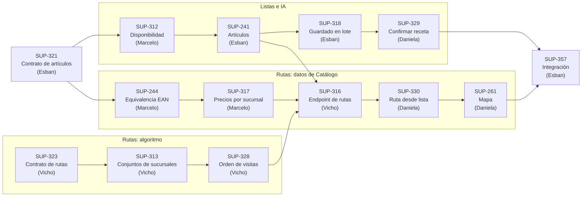

# Sprint 3 — Plan de realización

> **Sprint:** 05-11 al 03-12 de 2026 · **Responsable de organización:** Esban Vejar
> **Fuente de verdad de las tareas:** Linear (ciclo Sprint 3). Este documento explica el orden.

Linear nos muestra todas las tareas del sprint, pero no en qué orden conviene
hacerlas. Muchas dependen de otras: si alguien empieza una tarea cuya base
todavía no existe, se queda esperando o termina rehaciendo trabajo. Este
documento propone ese orden para que nadie se quede bloqueado y para que la
demo final llegue completa.

El objetivo del sprint es un solo recorrido que funcione de punta a punta:
**el usuario pide una receta al chat, guarda los productos en una lista y
calcula la ruta más conveniente entre supermercados reales.** Todo lo que
aparece aquí apunta a ese recorrido.

## Ruta crítica

La ruta crítica es la cadena de tareas que, si se atrasa una, atrasa todo el
sprint. En nuestro caso no hay una sola cadena sino tres, y las tres terminan en
la misma tarea: **SUP-357, la integración del recorrido completo.**

*GitHub dibuja este diagrama automáticamente. En un editor sin soporte de
Mermaid se ve como texto: cada `A --> B` significa "B necesita a A".*

Cómo leer el diagrama: cada flecha significa "esta tarea necesita a la anterior
para poder cerrarse".

- **Listas e IA.** Para guardar artículos en una lista (SUP-241), Listas
  necesita preguntarle a Catálogo si el producto existe y tiene stock
  (SUP-312). Con eso se puede guardar varios productos de una vez (SUP-318), que
  es justo lo que necesita la pantalla donde el usuario confirma los productos
  de la receta (SUP-329).
- **Rutas: datos de Catálogo.** Para comparar precios entre tiendas, primero hay
  que saber que un producto de Lider y uno de Jumbo son el mismo; eso lo
  resuelve el código EAN (SUP-244). Con eso, Catálogo puede entregar precios por
  sucursal con sus coordenadas (SUP-317), que es lo que el motor de rutas usa
  para calcular (SUP-316). Después el frontend lanza el cálculo (SUP-330) y
  muestra el mapa (SUP-261).
- **Rutas: algoritmo.** Vicho puede desarrollarlo en paralelo, porque parte de
  su propio contrato (SUP-323) y no necesita datos reales para empezar. Se
  junta con el resto en SUP-316.

El diagrama muestra cómo dependen entre sí las funciones, pero antes de todo eso
hay un punto de arranque. En total son tres los puntos críticos del sprint, en
el orden en que aparecen:

1. **El arranque: SUP-344 (Esban), SUP-345 y SUP-346 (Renato).** Son la
   convención de limpieza, los nombres de las variables compartidas y el CI. Los
   barridos de la ola 1 están bloqueados por estas tres tareas, así que **ningún
   integrante puede empezar a limpiar su servicio hasta que estén cerradas.** No
   aparecen en el diagrama porque no forman parte del recorrido de la demo, pero
   son lo primero que debe salir: Esban y Renato deben priorizarlas sobre
   cualquier otra tarea y cerrarlas el 07-11.
2. **El contrato de artículos: SUP-321 (Esban).** Define cómo se identifica un
   producto cuando pasa entre Catálogo, Listas, IA y Rutas. Si no está listo el
   07-11, Marcelo, Renato y Esban no pueden avanzar con seguridad en la ola 2.
3. **Catálogo: SUP-312 y SUP-317 (Marcelo).** Alimentan a casi todo el resto
   del recorrido, así que cualquier atraso suyo se nota en todo el equipo.

Los dos primeros puntos dependen de la planificación de Esban y Renato en la
primera semana; el tercero, de Marcelo durante la ola 2.

## Olas de trabajo

Dividimos el sprint (05-11 al 03-12) en cinco etapas, que llamamos olas. Cada
ola agrupa las tareas que ya tienen resuelto lo que necesitan, así nadie empieza
algo que todavía no puede terminar. Las fechas son una meta, no una barrera: si
alguien termina antes, adelanta lo suyo de la ola siguiente.

### Ola 0 — Acuerdos (05 al 07 de noviembre)

Antes de programar, acordamos las reglas y la forma de los datos. Es la ola más
corta y la más importante, porque todo lo demás se apoya en ella.

- **Esban** define la convención de limpieza (SUP-344) y el contrato de
  artículos (SUP-321). También ordena los scripts SQL (SUP-356) y prepara la
  cuenta de correo (SUP-188).
- **Vicho** define el contrato del motor de rutas (SUP-323) y corrige el bug de
  stock (SUP-331), que es corto y no depende de nadie.
- **Renato** fija los nombres de las variables compartidas (SUP-345), arma los
  workflows de CI que faltan (SUP-346) y limpia la raíz del repositorio
  (SUP-355).
- **Marcelo y Daniela** revisan los contratos SUP-321 y SUP-323, porque van a
  consumirlos. Mejor detectar ahora si falta un campo que descubrirlo a mitad
  del sprint.

### Ola 1 — Barrido (08 al 11 de noviembre)

Cada uno limpia sus servicios **antes** de agregar funciones nuevas: quita
código muerto, mocks y valores fijos, y mueve los tests a `tests/` (ver la
[guía del barrido](GUIA_BARRIDO_CODIGO.md)). Lo hacemos primero por dos razones:
es una exigencia del profesor y, si limpiáramos al final, los cambios chocarían
con todo el código nuevo.

- Esban: **primero** migra Motor de rutas a Go (SUP-348) y después barre
  Identidad (SUP-347). La migración va primero porque Vicho la necesita para
  empezar el algoritmo en la ola 2.
- Vicho: Catálogo y Gateway (SUP-349, SUP-350).
- Marcelo: Scraper Go, Control y Bot (SUP-351, SUP-352).
- Renato: IA conversacional (SUP-353).
- Daniela: Frontend (SUP-354).

### Ola 2 — Bases (12 al 18 de noviembre)

Con el código limpio y los contratos listos, cada uno construye la pieza que
los demás van a necesitar.

- **Marcelo** tiene la ola más cargada y la más importante: la equivalencia por
  EAN (SUP-244) y la consulta de disponibilidad (SUP-312). De la segunda
  dependen Listas e IA.
- **Esban** migra las referencias de productos en las listas (SUP-327) y hace
  la verificación de correo (SUP-231).
- **Vicho** programa la selección de sucursales (SUP-313), ya sobre el servicio
  migrado a Go. Puede probarla con datos creados en sus propios tests mientras
  Catálogo no entrega los reales.
- **Renato** deja funcionando el entorno integrado donde vive el chat (SUP-278).
- **Daniela** conecta el chat básico al endpoint real (SUP-253).

### Ola 3 — Funciones (19 al 25 de noviembre)

Cada servicio expone lo que le toca en el recorrido.

- **Esban**: guardar artículos (SUP-241) y agregar varios a la vez (SUP-318).
- **Vicho**: ordenar las visitas y calcular el traslado (SUP-328).
- **Marcelo**: precios por sucursal con coordenadas (SUP-317) y un caso con
  varias tiendas para probar (SUP-326).
- **Renato**: que la IA convierta una receta en productos del catálogo
  (SUP-325) y que responda bien cuando algo falla (SUP-315).
- **Daniela**: gestión de artículos en la lista (SUP-252) y vista de
  verificación de correo (SUP-249).

### Ola 4 — Integración (26 de noviembre al 03 de diciembre)

Se juntan las piezas. Vicho publica el endpoint de rutas (SUP-316) y Daniela
termina las tres pantallas del recorrido: confirmar la receta (SUP-329), pedir
la ruta desde una lista (SUP-330) y mostrar el mapa (SUP-261). Esban coordina la
prueba completa en el entorno desplegado (SUP-357) y todos apoyan corrigiendo lo
de su servicio.

El primer recorrido parcial debería probarse el 26-11, aunque falten piezas. Así
los problemas de integración aparecen con una semana de margen y no el día de
la entrega.

**¿Y las tareas Should y Could?** Las Should (SUP-338, 336, 255 y 341) están
asignadas y se hacen en los huecos de las olas 2 a 4, por ejemplo mientras se
espera a otro integrante. Las Could quedan sin dueño: las toma quien haya
terminado todo su trabajo Must, siempre dentro de su propio servicio.

## Qué le toca a cada uno

Las olas muestran el sprint completo; aquí está la misma información mirada
desde cada persona. Para cada uno se indica en qué orden trabajar, a quién
necesita esperar y quién lo espera a él o ella. Esto último es lo más
importante: si sabes que otra persona depende de tu tarea, sabes cuál priorizar.

**Esban.** Empieza por los acuerdos: la convención de limpieza (SUP-344) y el
contrato de artículos (SUP-321), que **es lo primero que debe salir**, porque
Marcelo y Renato lo necesitan para avanzar. Sigue con los scripts SQL (SUP-356)
y la cuenta de correo (SUP-188). Luego, en la ola 1, migra Motor de rutas a Go
(SUP-348) antes que nada más, porque bloquea a Vicho (SUP-313) y a sus propias
tareas de listas; después barre Identidad (SUP-347). Después vienen la
migración de listas (SUP-327), la verificación de correo (SUP-231), los
artículos (SUP-241) y el guardado en lote (SUP-318). Para cerrar SUP-241
necesita la consulta de disponibilidad de Marcelo (SUP-312). Termina
coordinando la integración (SUP-357). Lo esperan: Daniela (pantallas de listas
y verificación) y Vicho (el endpoint de rutas usa los artículos guardados).

**Vicho.** Puede trabajar casi sin esperar a nadie al inicio. Define el
contrato de rutas (SUP-323), corrige el bug de stock (SUP-331) y limpia
Catálogo y Gateway (SUP-349, 350). Luego programa el algoritmo en Go, cuando
Esban termine la migración del servicio (SUP-348): selección de sucursales
(SUP-313) y orden de visitas (SUP-328), probando con datos creados en sus
tests. Para publicar el endpoint (SUP-316) necesita los artículos de Esban
(SUP-241) y los precios por sucursal de Marcelo (SUP-317). Lo espera Daniela,
que no puede pedir la ruta desde la pantalla sin ese endpoint. Si le sobra
tiempo: SUP-338 (Should).

**Marcelo.** Es la pieza de la que más gente depende. Revisa el contrato de
artículos (SUP-321) apenas Esban lo publique, limpia Scraper y Control
(SUP-351, 352) y después se enfoca en Catálogo: equivalencia por EAN (SUP-244),
disponibilidad (SUP-312), precios por sucursal (SUP-317) y un caso con varias
tiendas para probar (SUP-326). Ojo: para SUP-317 necesita **dos** contratos, el
de artículos (SUP-321, Esban) y el de rutas (SUP-323, Vicho), porque los precios
por sucursal deben llegar con la forma que el motor espera. Los dos se cierran
en la ola 0, así que no cambia el orden, pero conviene revisarlos juntos. Lo
esperan: Esban y Renato (disponibilidad) y Vicho (precios por sucursal). Si
algo se complica, debe avisar el mismo día.

**Renato.** Sus primeras tareas preparan el terreno para todos: nombres de
variables compartidas (SUP-345), CI para los servicios que no lo tienen
(SUP-346) y limpieza de la raíz del repositorio (SUP-355). Luego limpia IA
(SUP-353) y deja el chat funcionando en el entorno integrado (SUP-278); Daniela
lo espera para conectar el chat. Después hace que la IA devuelva productos
reales (SUP-325), lo que necesita el contrato de Esban y la disponibilidad de
Marcelo, y que responda bien ante fallos (SUP-315). Si le sobra tiempo: SUP-336
(Should).

**Daniela.** Sus tareas están al final de casi todas las cadenas, porque la
pantalla es donde todo se junta. Empieza limpiando el frontend (SUP-354), que no
depende de nadie. Luego conecta el chat (SUP-253, cuando Renato tenga SUP-278),
la gestión de artículos (SUP-252, con SUP-241 de Esban) y la vista de
verificación (SUP-249, con SUP-231). En la última ola hace las tres pantallas
del recorrido: confirmar la receta (SUP-329), pedir la ruta (SUP-330) y mostrar
el mapa (SUP-261). Mientras espera, puede adelantar las Should: panel admin
(SUP-255) y guía de uso (SUP-341).

**Esperar no significa quedarse detenido.** Quien depende de otra tarea puede
programar contra el contrato acordado en la ola 0 y probar su código con datos
que el propio test crea. Lo que no se hace es poner datos falsos en el código de
la aplicación: el profesor pidió cero mocks. La tarea se cierra cuando la
dependencia real ya responde.

## Reglas para no bloquearse

Son seis acuerdos de trabajo. Cada uno existe porque evita un problema concreto
que ya vivimos o que es fácil que aparezca.

1. **Los contratos se cierran antes de programar.** SUP-321 (artículos) y
   SUP-323 (rutas) quedan listos el 07-11, con ejemplos de lo que se envía y lo
   que se recibe, revisados por quienes los van a usar. Si un contrato cambia
   después, quien lo cambia avisa a todos los que lo consumen. *Por qué:* si
   cada servicio interpreta distinto un campo, todo compila por separado y falla
   al juntarlo.
2. **Primero se limpia, después se agregan funciones.** El barrido de cada
   servicio se hace en la ola 1. *Por qué:* limpiar un código que otros están
   modificando al mismo tiempo genera conflictos de merge difíciles de resolver.
3. **Cada uno modifica solo sus servicios.** Los archivos que comparte todo el
   equipo tienen un único responsable: Renato para compose, k8s y CI; Esban para
   `infrastructure/db`. Si necesitas un cambio ahí, se lo pides a esa persona.
   *Por qué:* son los archivos donde más se pisan los cambios.
4. **PR pequeños, frecuentes y con CI en verde.** Un PR por tarea, hacia
   `develop`. Un PR no mezcla limpieza con funciones nuevas. *Por qué:* un PR
   pequeño se revisa en minutos; uno grande se queda días esperando y bloquea a
   otros. Ya nos pasó en el Sprint 1 con el PR #70, que hubo que revertir.
5. **Un bloqueo se avisa el mismo día.** Si una tarea de la que dependes se
   atrasa más de un día respecto de su ola, márcala como bloqueada en Linear y
   avísale al responsable de organización. *Por qué:* un atraso avisado a tiempo
   se reorganiza; uno que aparece al final ya no tiene arreglo.
6. **Las tareas Should y Could nunca pasan por delante de una Must.** *Por qué:*
   el sprint se evalúa por el recorrido completo funcionando, no por la cantidad
   de tareas cerradas.

## Riesgos de bloqueo y plan B

Estos son los atrasos que más daño harían, junto con lo que haremos si ocurren.
La idea es tener la respuesta decidida antes de necesitarla.

| Qué podría pasar | A quién afecta | Qué hacemos |
| --- | --- | --- |
| La convención (SUP-344), las variables (SUP-345) o el CI (SUP-346) no están listos el 07-11 | A todo el equipo: nadie puede empezar su barrido | Esban y Renato las hacen antes que cualquier otra tarea. Si el CI se complica, se acuerdan igual la convención y las variables, y los barridos empiezan; los PR esperan el CI para fusionarse |
| El contrato de artículos (SUP-321) no está listo el 07-11 | Marcelo, Renato y Esban quedan sin base para avanzar | Esban lo prioriza junto con SUP-344. La revisión se hace por mensaje, sin esperar una reunión |
| La migración de Motor de rutas a Go (SUP-348) se complica | Vicho no puede empezar el algoritmo y se atrasan las listas | Tope de dos días. Si no alcanza, se vuelve al servicio en Python y se hace solo el barrido |
| Se atrasan la disponibilidad (SUP-312) o los precios por sucursal (SUP-317) | Listas, IA y Rutas al mismo tiempo: es el principal cuello de botella | Vicho apoya a Marcelo en Catálogo, que conoce bien porque hizo su refactor |
| No hay cuota en el clúster para desplegar la IA (SUP-278) | El chat no llega al frontend | Se usa Compose como entorno de integración, como ya contempla SUP-278 |
| Pocos productos reales tienen código EAN (SUP-244) | El motor de rutas tiene pocos productos para comparar entre tiendas | Acotamos la demo a los productos que sí tienen EAN y lo explicamos con datos |
| Un barrido toma más de lo previsto | Se retrasa el inicio de la ola 2 | Cada barrido tiene un tope de dos días. Lo que quede pendiente se anota y se termina en paralelo |
| La integración (SUP-357) se deja para el último día | La demo llega sin ensayar | El 26-11 se hace un primer recorrido con lo que exista, aunque esté incompleto |
